# The ground as one sheet: a plan for the map build and the ground's drawing

Written for the co-developer to review, and then to be implemented from this document alone (the conversation
that produced it will be compacted). It answers his question: should the map build be planned more
formally (the layer order, what may move what, what is cut or removed), and is there one
architecture that fixes many of the glitches he saw at once and draws faster?

Everything here was read from the code at `f5b99c63` (the fork's `main`, which is
`claude/map-integrate`, live), in the worktree `~/src/cd-ground-plan`, branch
`claude/ground-plan`. No map was built and no browser was run: map building is paused. Numbers
marked *measured* come from small read-only scripts over the packed squares in
`web/public/maps/combe-down/`; numbers marked *estimate* are reasoning, not measurement. Where a
mechanism is inferred rather than read, it says so.

## Contents

1. [The short answer](#1-the-short-answer)
2. [How the map is built and drawn today](#2-how-the-map-is-built-and-drawn-today)
3. [What causes each thing the co-developer saw](#3-what-causes-each-thing-the-co-developer-saw)
4. [The proposed architecture](#4-the-proposed-architecture)
5. [Performance](#5-performance)
6. [Measures: new checks and a walking probe](#6-measures-new-checks-and-a-walking-probe)
7. [Stages](#7-stages)
8. [Risks, open questions for the co-developer, and what was rejected](#8-risks-open-questions-for-the-co-developer-and-what-was-rejected)
9. [How to resume](#9-how-to-resume)
10. [Baselines, stage 0](#10-baselines-stage-0)
11. [Baselines, stage 0: walking and drawing](#11-baselines-stage-0-walking-and-drawing)
12. [Stage 3 as built: the ground sheet](#12-stage-3-as-built-the-ground-sheet)

---

## 1. The short answer

**The hypothesis is half right, and the half that is wrong matters.**

- *Right:* most of the glitches come from the ground being several things drawn on top of one
  another, each with its own idea of the height, fitted to the one below and hidden where they
  disagree. Everything the co-developer listed except the church and the traffic lights traces back to that.
- *Already done:* the partition (`tools/partition/`) has already made **the plan view** one sheet
  for streets, pavements, paths, drives and gardens. Those faces are noded to each other, share
  every corner along their edges, and leave no gaps or overlaps (`watertight.py`: gaps and overlaps
  0 across the city). So "neighbours share exact edges" is mostly true today, for the street faces.
- *Not done, and the real cause:* **heights.** A point on the ground gets its height from one of at
  least six different functions, depending on what is asking:
  - the writer's street level, for road and pavement faces;
  - the terrain grid as drawn, let down at load under streets, for paths, front paths and drives;
  - the survey's grid before it was let down, for the height you *walk* at on a path;
  - the steps' own tread layout;
  - the bridge deck, the tunnel bore and the canal's banks, each its own function;
  - each pond's own flat level.

  On top of that, the terrain grid is drawn **everywhere**, under every face, and is hidden by
  pushing grid points down, by `discard` in the shader and by depth offsets. Where those
  disagree by centimetres you get exactly what the co-developer saw.
- *Outside the sheet entirely:* water, the river's banks, the canal and its locks, bridges,
  tunnels and steps. Each is built from its own outline at its own heights and laid over, or
  punched through, the ground.
- *Drawn is not solid:* steps are drawn but walked as a ramp; tunnel walls are solid along one
  line and drawn along another; you walk a path at a different height from where it is drawn; a
  bridge's ceiling assumes one deck depth for every kind.

**Recommendation.** Finish what the partition started, in three moves:

1. **One ground sheet per square, baked.** Every surface becomes a face of one triangulated sheet
   with one height per corner, solved in a fixed order. The surfaces are carriageway, pavement,
   path, step footprint, drive, water, bank, verge, garden and open land. Drop the sinking and
   hiding. The open land away from any face stays the cheap 4 m grid (it is 80 KB of a 0.9 MB
   square), and only the grid cells a face touches are re-cut. So it is a **hybrid sheet**, not a
   full irregular mesh.
2. **Structures attach to the sheet along named edges:** bridges, tunnels, steps and locks. The
   same shape is drawn and is solid.
3. **One walk surface:** the game stands you on exactly the triangles it draws.

Ship it in stages, **with the cheap runtime fixes first** (steps you walk on, tunnel walls where
they're drawn, paths walked where drawn, the locks' edges). Then the build rules that fix tilted
paths, hillside through footbridges and land in the river within today's format. Then the sheet
itself, behind a URL flag, until the measures say it is better.

**Speed.** The gain is real but modest, and comes from fewer draw calls (ground meshes merged by
class, no depth-offset materials), no ground drawn under faces (11 to 22% of a town square's area),
and less load-time work. It does **not** come from simplifying flat ground: Bath's 4 m lidar grid
barely simplifies at 5 cm (5 to 20% fewer triangles, *measured*). Download must be held flat. That
is a gate, not a hope.

---

## 2. How the map is built and drawn today

### 2.1 The pipeline

```mermaid
flowchart TD
  subgraph data["Data (measured unless marked)"]
    DTM["EA lidar DTM, 1 m → 4 m terrain grid"]
    OVT["Overture buildings, roads"]
    OSM["OSM roads + tags, water, bridges, barriers"]
    LID["lidar walls, roofs, canopy"]
    PAR["INSPIRE parcels (Bath)"]
    CAN["canal.json (tools/canal.py): pounds, locks, tunnels"]
    RAIL["rail.json (tools/railway.py)"]
  end
  data --> PM["prep_map.py --tile (per square, 15-cell margin)\nterrain grid; roads + bridges + tunnels (tn);\nwater beds dug, banks sloped, canal bed dug;\nbuildings; guessed gardens; trees; furniture"]
  PM -->|"prep squares (data/raw/.../partition/prep/)"| P1
  subgraph part["tools/partition (pipeline.py)"]
    P1["street graph (once)"] --> P2["corridors per edge: carriageway + pavements"]
    P2 --> P3["structures.py: bridges, road heights, grading"]
    P2 --> P4["worked blocks → plots (parcels, lidar, rules)"]
    P3 --> P5["assemble per square"]
    P4 --> P5
    P5 --> W["write_tile.build_tile:\nrd from corridors; fill_dug_ground + lay_ground edit t;\nsettle boundaries; sf street faces; br/gt/fp/dv; clearances"]
  end
  W --> PK["web/public/maps/<map>/<ti>_<tj>.json → pack_squares.mjs (.pack.gz)"]
  PK --> G
  subgraph G["game (per square as it streams in)"]
    T1["terrain mesh from t, let down under faces (sinkUnder),\nhidden by discard: canal cut, lock pits, tunnel mouths"]
    T2["sf faces: road/pave at written z + lift;\npaths/drives at drawn ground + 0.04, cut on grid; kerb faces"]
    T3["bridges (world.ts KINDS), railway bridges (railbridge.ts)"]
    T4["tunnels (tunnels.ts) and canal bores (canal.ts)"]
    T5["canal water, locks (canal.ts), banks (works.ts)"]
    T6["ponds flat, streams as ribbons, weirs"]
    T7["steps' treads (furniture.ts)"]
    WK["walk: map.ground = surface(): tunnel/deck → face → drawn ground;\nfloors: canal, railway, roofs, set pieces; walls: barriers, parapets, linings, portals, canal walls"]
  end
```



### 2.2 The build order, and what is measured and what is guessed

| order | what | measured or guessed | where | may move | may cut or remove |
|---|---|---|---|---|---|
| 1 | terrain grid, 262 × 262 points at 4 m per square | measured (EA DTM, resampled) | `prep_map.py` 116–199 | — | — |
| 2 | road and path centre lines and their tags | measured (OSM, Overture) | `prep_map.py`, `partition/graph.py` | — | — |
| 3 | road heights: profiles, smoothing, grading, bridges carried, dips under bridges | rules over measured ground | `prep_map.py` 593–1335, `tools/structures.py`, `tools/profiles.py`, `tools/grading.py` | road heights; **then digs and fills the grid to them** | — |
| 4 | the grid flattened under roads and the railway, cut over tunnels, dug for water beds and the canal | rules | `prep_map.py` 1425–2144 | the grid | — |
| 5 | buildings (footprints, eaves, roofs) | measured (Overture + lidar) | `prep_map.py` 2221–2703 | — | streets stop at their walls |
| 6 | lidar walls | measured | `tools/walls.py` | — | — |
| 7 | corridors: carriageway and pavement widths fitted between 5 and 6 | fitted to measured | `partition/corridors.py` | street lines up to 2 m off buildings | guessed boundaries |
| 8 | plots and boundaries | parcels and lidar where they exist, else guessed | `partition/plots.py`, `settle.py` | — | an unseen parcel line is undrawn |
| 9 | the writer: records, **the grid edited again** (`fill_dug_ground`, `lay_ground`, `_unspiked`), faces, walls and gates | rules | `partition/write_tile.py` `build_tile` 7025–7280 | the grid; path lines (`settle_on_laid_ground`) | walls off streets, rail, canal (half + 0.8 m), water (+0.8 m); trees off faces |
| 10 | small things: trees, shrubs, street items, cars | measured canopy, OSM, rules | `prep_map.py` 3143–4062, writer `drop_clashes` | moved off faces up to 2.5 m | dropped if they can't move |

Taken unchanged from `prep_map.py` by the writer: water (`wp`, `wl`), the canal and the railway
(side files), level crossings, buildings, doors, and tunnels (`tn`), where the writer only sets
`hw`. The writer copies the grid and edits it; it never touches the grid's outer ring or the cells
under buildings.

### 2.3 How a square is drawn and walked, layer by layer

Line numbers are `web/src/world.ts` unless another file is named.

| layer | how its height is chosen | how it is kept from clashing | draw calls (*estimate*) |
|---|---|---|---|
| **terrain** | the grid `t` (decimetres over `z0`), minus `sink` per point; split a,b,c / b,d,c (760, 817–829) | **never cut**: the full index buffer is drawn. Under road and pavement faces it is let down (road 0.3 m, pavement 0.08 m below; points near an edge put just under it; `clearOf` lowers corners till their triangles clear: 568–700). Grass beside a face is raised up to 0.25 m (`KERB_RAISE`, 697). Hidden by `discard` inside the canal works (`vCut<0`, 953), lock pits (`canal.ts lockPits`), canal bores and tunnel mouths (`tunnels.ts`, up to 40 m in). | 9 tiles of 48 cells, plus a far 12 m mesh and the works |
| **road, service, pavement faces** (`sf`) | the writer's z: the ground under the nearest street's centre line at that station (`write_tile._level_at` 3372), plus a lift (road 0.07, pavement 0.17) | polygonOffset (road 3, pavement 2, service 2); kerb and edge faces from `sf.e` (1949–1995); a free edge runs down to the drawn ground, and over 0.45 m it is drawn as Bath stone | 4–5 |
| **path, front path, drive, grass/dirt/gravel paths** | **each corner on its own**: drawn ground at that point + 0.04 (`surfaceFaces.at`, 1906), then cut along the grid's lines and diagonals so each piece lies on one ground triangle (`groundTris` 836–892) | polygonOffset 1; the terrain is **not** let down under paths | 1–2 (merged with a kind attribute) |
| **bridges** | the record's span points; deck top at `top − lift + 0.03` (1497) | the terrain under a deck is only let down to the centre line's ground − 0.3 m within half + 0.5 m (592); never cut | 1–2 per square with bridges |
| **tunnels** | tube rings resampled every 1.5 m (`tunnels.ts` 81–84, 269–338), portals, wing walls, cutting | the terrain over the mouths is discarded in boxes | ~3 per 90 m of tube, ~8 per portal |
| **canal** (the maintainer's) | each pound flat at `lv`; locks' chambers, gates, coping, paving at their own levels (`canal.ts lockWalls` 848–880); banks, towpath, verges, retaining walls from `works.ts` | terrain discarded where `sd < 0` (signed distance interpolated over 4 m triangles); an apron and skirt cover the slivers that leaves (`works.ts` 449–458) | several |
| **ponds and the river** | flat at `w.z`: the lowest lidar on its ring + 0.1 (`prep_map.py` 1785) | **not cut** against the banks: the terrain hides the edge by depth (2037–2074) | 1 |
| **streams** | ribbons 1.6 m wide at the true ground + 0.05, each edge on its own, so they tilt (1110–1138) | trimmed out of bores (`outsideBores`) | 1 |
| **steps** | treads climb evenly from the ground at the record's first point to its last, never under the ground on the line, never steeper than 0.7 (`furniture.ts stairLayout` 906–942) | each tread is a solid box from the **lowest** ground across it − 0.15 m up to its top (869–872) | 1 |

**Walking** (`world.ts surface` 2831–2837, passed to `map.standOnDrawn`):
- in a tunnel or on a deck, that wins;
- on a road or pavement face, the face's level + lift;
- **on a path face, `trueGround + 0.04`: the survey's grid before it was let down**, not the
  drawn ground the path was drawn on;
- elsewhere, the drawn ground.

Steps' treads are not floors (only the canal, the railway, roofs, set pieces and a few minigames
push floors: `world.ts` 2012–2017), so you walk the ramp under them. Tunnel walls are the floor line
offset sideways (`map.ts` 582–586); canal tunnels use `works.bore`. A bridge's ceiling is
`overhead − DECK_DEPTH`, with `DECK_DEPTH` 1.1 m for every kind (`map.ts` 228, 1314–1319).

### 2.4 What the partition already changed, and how far it got

Against its own plan (`docs/partition-build-plan.md`):

| stage | what it promised | state |
|---|---|---|
| 1–3b | plots as unions of faces of one polygonize; parcels; the whole city; each street and block built once so squares agree | **done**: loose ends inside 0, overlap 0, neighbours agree at 1 cm on all 236 shared edges |
| 4 | the partition writes the game's squares | **done and live**: `prep_tiles.py` runs `partition/stage.py` after `prep_map.py` |
| 5 | "one surface in the game": `sf` as a triangle mesh with classes, the game draws it instead of terrain + strips, `ground()` reads the mesh | **partly**: `sf` exists and is drawn for streets, pavements, paths, drives and front paths, but **as faces over a terrain that is still drawn everywhere**. Walking reads faces only for roads and pavements. Water, banks, bridges, tunnels and steps are not in it. `tools/partition/surface.py` (a true one-surface triangulation with heights per class) is a **check only** and never reaches the game. |
| 6 | tuning and the switch, removing the old tools | ongoing (`docs/partition-revisit.md`) |

So the hypothesis's step (1) is about two-thirds built in plan and about a third built in height.
This plan is, in effect, **"finish stage 5 properly and bring water and structures into it"**,
with the lessons of the revisit list.

---

## 3. What causes each thing the co-developer saw

Mechanisms are read from code unless marked *(inferred)*. "Fix" points at the stage in §7.

### 3.1 Footpaths

| what the co-developer saw | mechanism | fix |
|---|---|---|
| **holes all over paths** | (a) A path is drawn 0.04 m over the drawn ground, and the ground is not let down under it. Where the ground rises between the path's corners, it comes through. `groundTris` cuts paths along the grid to stop this, but leaves a triangle whole when the ground is within +2/−3 cm (`FLAT_UNDER`, added 5 November). Paths have **no interior points** (`write_tile.street_surfaces`). (b) Path faces dropped or left as slivers: 1,133 m² of path undrawn across the city (`watertight.py`, revisit list); paths dropped inside a pavement band + 1 m; paths cut 5 m either side of a railway bridge. (c) Thinned street faces dip 2–12 cm in long triangles and let raised ground through (rule 20, revisit list, 6 November). (d) `level_cuts` deliberately leaves a 0.15 m slot (`LEVEL_GAP`) between two streets whose levels differ by over 1.5 m, relying on a kerb face to cover it. | stage 1 (walk), 3 (sheet: no ground under any face) |
| **paths tilted sideways** | Every path corner takes the ground at that point, both in the writer (`street_surfaces.point`, `flat` → ground, 4041) and in the game (`surfaceFaces.at`). Nothing makes a path's two edges level. *Measured*, by sampling the ground across each path's width: on Widcombe's square (1_2), **66% of path length tilts more than 5° and 44% more than 10°**. Broad Quay's (0_2): 45% and 23%. The village (1_1): 38% and 20%. The city centre (0_3): 20% and 11%. | stage 2 (level paths in today's format), 3 |
| **different materials joining messily** | Separate meshes with different depth offsets (path 1, pavement 2, road 3). A path's corner and a pavement's corner at the same place are **different points** (the writer's point key includes `on_ground`), so the meeting is a step face drawn down from the higher piece (1970–1975), and a gravel path, a pavement and the grass each lie at their own height there. | 3 |
| **pavement on a road above slumping into a footpath below** (Broad Quay ~−1052,1663) | A pavement corner takes the level of the nearest street. Where two streets' levels differ by **less than 1.5 m** (`LEVEL_STEP`), nothing cuts between them, and the faces between are stretched to join them (revisit list, "Street faces"). The pavement's back edge falls up to 0.12 m towards the ground (`PAVE_FALL`). A corner beyond a street's reach falls back to the ground. So an upper pavement beside a lower path is pulled down into it along a sloping face. *(The exact corner at Broad Quay is inferred.)* | 2 (retaining edge at under 1.5 m), 3 |
| **pavement meeting gravel with lumps; pavement just stopping** (Lower Bristol Road ~−1138,1667) | Lumps: the grass beside a face is raised by up to 0.25 m to meet it (`KERB_RAISE`), and the 4 m grid's triangle between a pavement and a gravel path can only be one plane. Stopping: a pavement exists only where the corridor fit gave that stretch a pavement (`pv`). `verge_out_of_town` removes pavements beside out-of-town trunk roads, and a stretch can end where `widen_to_paving` splits a record. *(Which of these at that spot is inferred.)* | 3; the stopping is data, but measure it (§6, M4) |
| **pavement wedging down to a riverbank** (Rossiter Road ~−726,1607) | A face's free edge runs down to the drawn ground, and over 0.45 m it is drawn in Bath stone (1979–1986). Near a steep bank, the 4 m grid falls away from the pavement's back within one cell, so the edge face becomes a tall wedge. *(Inferred.)* | 3 (bank as a face with a retaining edge) |

### 3.2 Bridges

| what the co-developer saw | mechanism | fix |
|---|---|---|
| **metal footbridges missing their ends** | A deck whose last point falls steeply to the ground "ends in the air" (revisit list, 27 October). A record joining a deck at a three-way junction stays a separate bridge (`joinSpans` follows only the straightest piece: 1328–1339). At a square's edge a span has no cap, abutment or approach (1503, 1516, 1644), so it depends on the next square's piece ending at the same point. The strip's off-span end point is drawn at true ground, while the face beside it is at the writer's level *(inferred: a step or slit there)*. | 4 (attachment edges) |
| **odd walls and gaps on road bridges** (Wells Road ~−1243,1642) | The lidar sees a bridge's own side and it was drawn as a second wall under the parapet. `deck_skirts` cuts it in a 0.8 m strip, which only shortens it (Mill Lane: 2.3 m → 1.5 m). Separate parapets on unjoined records at junctions. | 2 (skirt from the deck outline), 4 |
| **railway viaduct: parapet crack, stretched stone under arches** (~−994,1621, ~−1019,1641) | Railway bridges are `railbridge.ts`, built per run of openings from the line's heights. Over nothing, an arch flatter than 0.3 of its width is "built as the plain wall it would look like", with its face running down to ground sampled sparsely, so the stone is stretched. The crack is *(inferred)* where two runs (or a square's edge) meet without a shared end. | 4 (same attachment rules for rail bridges) |
| **no room for towpaths under bridges** | The ceiling under any bridge is the deck's top − 1.1 m for every kind, flat across the whole deck (`map.ts ceiling`). An arch's drawn barrel comes lower at its sides than that, and a beam's underside is lower than a stone deck's. A recent commit (`3f95fe6c`) made bridges solid underneath, so you now bump into that flat ceiling. The canal's own bridges are 2.8 m over the water, but the towpath's headroom is not separately kept. | 1 (ceiling from the kind and the arch's profile) |
| **hillside lumps on a footbridge** (~−710,1618) | The terrain is never cut under a deck, only let down near its centre line (592). The writer digs the grid under a span **only if the span has four or more points** (`lay_ground`, `if len(st) < 4: continue`), and points are about 4 m apart, so **a footbridge under about 12 m is never dug**. A footbridge's deck is 0.45 m deep, so the 4 m grid's bank under its end comes through. | 2 (dig under every span), 3 |

### 3.3 Tunnels

| what the co-developer saw | mechanism | fix |
|---|---|---|
| **gappy** | Each `tn` record's end ring uses only its own last segment, so where two records meet at an angle a wedge opens on the outside (`tunnels.ts`) *(inferred)*. Every record end not on a square's edge is treated as a portal *(inferred)*. The tube's rings are resampled with no mitre widening at bends. | 1 (join records, mitre), 4 |
| **some block walking in** | `portalFaces` collision has piers only where side-by-side openings don't overlap, while the drawn slab cuts every hole. The tunnel's floor for walking is the centre line, while the drawn pavements inside are 0.15 m higher (`floorAcross`). Rule 16 counts mouths whose floor stands over 1 m off the ground outside. | 1 |
| **some you can walk out through the sides** | The solid walls are the floor line offset by `boreHalf` at the original points (`map.ts` 582–586, `offsetLine` with no mitre). The drawn tube follows the resampled, smoothed line. `boreAt` measures to the segment, so on the outside of a bend the floor reaches further than the wall *(inferred)*. At a join between records the two offset walls don't meet, which leaves a gap *(inferred)*. Canal tunnels are a different system again: one straight box from portal to portal (`canal.ts canalBores`), walked by `works.bore`, with linings that block only down in the bore. | 1 |
| **glitchy; inside the tunnel broken** | The hill over the tube is the ordinary terrain, hidden in boxes up to 40 m into each mouth. Further in, where the tube runs under less than an arch of hill, the hill shows inside the tube (a documented trade-off). | 4 (the sheet keeps cover over every bore) |
| **a path draped over a portal** | A path on the hill over a tunnel is laid on the survey's ground. The hill over a portal is "a step on the 4 m grid beyond the headwall's width" (revisit list). Paths are kept off the *canal's* tunnels (`canal_bores`) but not off road and rail portals. | 4 (the portal line is a sheet edge) |

### 3.4 Locks (the maintainer's work: edge fixes only)

The canal, its locks and banks (`web/src/canal.ts`, `web/src/works.ts`, `tools/canal.py`) were
built by commits authored "Claude" that reached the fork from `spencer/main`. They are the maintainer's
agents' work *(inferred from the history)*. The co-developer's later work added marinas and the canal bed. Keep
all of it, and fix only its edges.

| what the co-developer saw | mechanism | fix |
|---|---|---|
| **visual glitches on the edges of pieces; white slivers** | (a) The works bank beside the wing walls is set to the wing coping − 0.05 m and interpolated between 4 m stations (`works.ts` 99–100). The lock paving steps every ~1.5 m (`canal.ts` 864–874). Two surfaces 5 cm apart and not parallel give slivers and fighting. (b) The canal's cut in the terrain is a signed distance interpolated over 4 m triangles, so its edge is never the bank's true line. An apron 0.1 m under the drawn ground covers what it can. | 1 |
| **strips floating in water** | The pound's water is forced to 2.6 m half-width at the gates and between the wing walls (`canal.py` 341–349). The lock's walls stand at 2.15 m (`LOCK_HALF`). So 0.45 m strips of water and channel side stand outside the wing walls, over the paving. | 1 |
| **sky through the bottom of Bath Deep Lock** | **Not confirmed.** Candidates: the lock's water plane is 0.8 m shorter than the chamber, which leaves 0.4 m at each end (`canal.ts` 720). The pit's discard box keeps terrain only from `zl − 1.7` up. The partition's `fill_dug_ground` / `lay_ground` edit the grid at Pulteney Road over Deep Lock, and `structures.py` does not dig the chamber the way `prep_map.py` does (2047–2057). Deep Lock's wings run 37.6 m. Find it with the probe first (§6, M11). | 1, after diagnosis |

### 3.5 Ground and water

| what the co-developer saw | mechanism | fix |
|---|---|---|
| **land poking out of the canal into the river** | The pound below Bath Bottom Lock (`lv` 15.8) runs on 24 m to (−694.5, 1640.4), **inside the river's polygon** (*measured*, `combe-down-canal.json` and square 1_2). The works build its channel sides, banks, retaining walls and square-ended aprons wherever the run ends (`works.ts` 464–476), and know nothing of the river (`works.water` checks only canal pieces). `prep_map.py` also raises the non-bed part of an OSM canal polygon to `lv + 0.3` (1802), which overlaps the river. | 2 (the canal stops at the river's edge) |
| **water at two heights with a cliff between** (~−701,1632) | Each water body has its own level. *Measured* in square 1_2: river pieces at 15.9 and 15.8, the canal piece at 16.0, the canal's tail pound at 15.8. Nothing makes touching water agree, and the canal's stone side stands between them. The level differences are small; the "cliff" is the canal's side and bank standing in the river *(inferred)*. | 2 |
| **banks as brown cliffs** | River beds are dug 0.6 m under the water and banks sloped down within a band (`prep_map.py` 1817, 1895–1917), but on a 4 m grid a whole bank is one or two triangles. Any grid point steeper than 0.45 is blended up to 75% towards earth brown (510, 766), and the canal's verges take that colour. | 3 (banks are faces with their own material and slope) |
| **fences standing in water and on towpaths** | Walls are cut only off the canal's water + 0.8 m and off ponds + 0.8 m (`write_tile.blocked_ground` 6608–6650; `map.ts extraCorridors`). The towpath, verges, locks' paving and the river's banks are not blocked ground. Mapped fences are kept by rule (the Bathwick Hill one is OSM's). Registered parcels often run to the middle of a river *(inferred)*. | 2 |
| **garden walls on footpaths** | A seen wall (lidar or mapped) stays where it stands, and is only opened where a path crosses it. A wall *along* a path within its width is not removed. The path's width is the writer's, trimmed from a wider corridor room (`PATHW`). *(Which case applies at each place is inferred.)* | 2 (M13 counts it) |

### 3.6 The two small ones

- **St Mark's, Widcombe drawn as a plain building.** A building is a church only if its class is
  `church` or `chapel`, or its name contains "Chapel" or is "Holy Trinity" (`tools/buildings.py`
  792, `prep_map.py` 2387). A former church now used for something else carries its new use as its
  class. The rule should read the building's *form*, which OSM keeps on `building=church|chapel|
  cathedral`, or `historic=church`, `disused:amenity=place_of_worship` or `amenity=place_of_worship`.
  (The name rules are Bath-only and should go too: data over custom.) Small; stage 2.
- **Traffic lights often look blank.** The three lamps are plain dull colours (`#d8261d`,
  `#8a6a1a`, `#2a6e3a`) with nothing lit, and a head faces one way only (`furniture.ts signal`
  114). Under the retro grade and fog they read as a black box. Light one lamp (emissive, on a
  cycle; the same for everyone from the shared clock) and put a head on both faces. Small; stage 1.

### 3.7 What this says about the hypothesis

| hypothesis | verdict |
|---|---|
| separate stacked layers, each fitted onto the one below | **yes for heights**, with the twist that the terrain is drawn under everything and hidden rather than cut |
| cracks and lumps where they disagree by centimetres | yes: `FLAT_UNDER`, `KERB_RAISE`, `PAVE_FALL`, the 0.04 lift, depth offsets and the 4 m signed-distance cut are all tolerances for that disagreement |
| neighbours should share exact edges | **already true in plan for the street faces**; not true for water, banks, canal, structures and steps |
| one set of height constraints | not done; this is the main work |
| structures with attachment edges | not done; bridges, tunnels and steps each guess where they meet the ground |
| one shape drawn and solid | not done for steps, tunnels, path walking or bridge ceilings |
| speed from no overdraw, simplification, fewer meshes | **partly**: fewer meshes and no ground under faces, yes; simplification gives little in Bath (§5) |

---

## 4. The proposed architecture

### 4.1 The precedence order: who moves whom, who cuts whom, what is removed

The order the build already uses is kept and written down as rules, with water and structures put
in their proper place. **A thing may only move, cut or remove things in tiers below it.** Within a
tier, measured beats guessed.

| tier | contents | measured or guessed | may move | cuts (in plan) | removes |
|---|---|---|---|---|---|
| **0. Fixed** | buildings; real walls (mapped, lidar); water outlines (rivers, ponds, the canal's channel and locks from `canal.json`); the railway's bed | measured (the canal is the maintainer's geometry: an input, not rebuilt) | nothing; never moved | everything below | — |
| **1. Structures** | bridge decks and abutments; tunnel bores and portals; lock chambers; flights of steps | data placed by rules | their own ends, to their attachment edges only | the sheet at their **footprints on the ground** (abutment, portal cutting, flight), never under a deck's gap or over a bore | guessed things in their clearance |
| **2. Corridors** | carriageway, pavement, verge | fitted to tier 0 | street lines, up to 2 m off buildings (as now) | tiers 3–5 | guessed boundaries on them |
| **3. Ways on foot** | paths, front paths, drives, the towpath (the canal's), cycleways | data widths, fitted | sideways only to clear tier 0 (as now) | tiers 4–5 | guessed boundaries along them; trees and shrubs on them |
| **4. Land** | banks, gardens and plots, open land | parcels and lidar, else guessed | — | — | — |
| **5. Small things** | trees, shrubs, street items, parked cars, guessed fences and hedges | mixed | off higher tiers, up to 2.5 m (as now) | — | themselves, if they can't move |

New rules this adds to today's:
- **Water is tier 0.** A fence, wall or hedge may not stand on water, the towpath, a verge, a lock's
  paving or a bank face (a measured one is cut there; a guessed one goes). The canal's works stop
  at the edge of the water they open into (the river): its last pound takes the river's level if
  within 0.3 m, or meets it at a lock or weir edge.
- **Touching water agrees.** Two water bodies that touch take one level (the larger body's) unless
  a step object (a lock, a weir in `wf`) stands on the line between them.
- **A structure attaches; it doesn't drape.** It has named edges (§4.4) where it meets the sheet,
  and the sheet's corners along those edges take the structure's heights.

### 4.2 The ground sheet

**One sheet per square: a planar partition with one height per corner.** Its classes:
`carriageway`, `service`, `pavement`, `path`, `front`, `drive`, `flight` (a step footprint), `towpath`,
`water`, `bank`, `verge`, `garden`, `open`, and `hole`. A hole is where a structure owns the
surface: an abutment's footprint, a lock chamber, a portal's cutting floor if the tunnel owns it,
or a building.

Two kinds of edge:
- **ordinary**: both faces share the corners, one height, so no crack can be built;
- **step edges**: a kerb, a retaining edge, a lock wall's top, a water's edge, a portal line, the
  edge of a flight. They carry **two heights**, one per side. The game draws a vertical face
  between them (stone over 0.45 m, as now) and treats it as a step or wall for walking. Every
  vertical face in the ground is one of these, named and counted; none is a side effect.

**A hybrid sheet, not a full irregular mesh.** The 4 m grid is 80 KB of a 0.9 MB square
gzipped, against 330 KB for today's street faces (*measured*), and drawing it costs one index
buffer.
- Grid cells **no face edge touches** stay plain grid cells, drawn and walked exactly as today's
  triangles.
- Cells a face edge touches are taken out of the grid (a bitmask per square, 8.5 KB raw, a few
  hundred bytes zipped). Their area is filled by the sheet's own constrained triangulation, which
  includes the grid's corner points on the boundary of the cut area. So the sheet meets the grid
  with no T-junction, and no ground is drawn under any face.

This keeps the download close to today's while removing every hidden layer.

### 4.3 Heights: one ordered model

Heights are **assigned in a fixed order, and a later step may never move a corner an earlier step
fixed**. Deterministic, local, explainable. There is no global least-squares solve (rejected,
§8.3).

| step | what is fixed | rule | today's equivalent |
|---|---|---|---|
| 1 | water | flat at its level; touching bodies agree (§4.1) | `wp.z`, canal `lv` |
| 2 | structure attachment edges | an abutment's top edge = the deck's top there; a portal's floor line = the bore's floor; a lock's coping = the maintainer's coping; a flight's landings = the faces they land on (§4.4) | scattered |
| 3 | carriageways | the existing profile along the centre line (`structures.py`, `grading.py`), **flat across** the carriageway as now | `_level_at` |
| 4 | pavements | kerb over the carriageway's edge (as now); back edge within `PAVE_FALL` of that. Where the next face is lower or higher than that by more than `PAVE_FALL`, the edge is a **retaining step edge**, not a stretched face. This replaces the 1.5 m `LEVEL_STEP` cut for faces that meet. | `PAVE_FALL`, `level_cuts` |
| 5 | paths, front paths, drives, flights' footprints | **level across**: both edges take the height of the centre line's station opposite (projection onto the path's line). **Along the line**: the ground under the line, smoothed (the street profile's filter), its grade capped; too steep becomes a flight (§4.5). Where a path meets a pavement or road, it takes that face's edge height over the last 1.5 m (a dropped kerb, a ramp), unless the gap is a kerb (≤ 0.17 m), which stays a step edge. | none: per corner ground |
| 6 | banks and verges | between the water's edge (level + 0.15 m freeboard) and the top of the bank (the survey's ground at the bank face's far edge). Corners in between are interpolated by distance across, but never under the water's level + 0.1. Over 1 in 1, the face is drawn as stone revetment, not brown earth. | `prep_map.py` bank slope + earth blend |
| 7 | gardens, open land | the survey, **carved to meet** the faces fixed above: within a batter zone beside each face (fill 1 in 2, cut 1 in 1.5, at most 3 m wide), the ground is blended from the face's edge height to the survey. Where the batter would need more than 3 m, a retaining step edge is placed at the face's edge (a low wall drawn as such). Under a deck: at most the deck's underside − clearance (§4.4). Over a bore: at least the crown + 0.6 m. | `lay_ground`, `_unspiked`, `sinkUnder` |

**Thresholds** (named constants at the top of the module, as the partition's rules are):

| constant | value | why |
|---|---|---|
| path cross-slope | 0 by construction; measured tolerance 2° | The co-developer's requirement |
| `BATTER_FILL`, `BATTER_CUT`, `BATTER_MOST` | 1 in 2, 1 in 1.5, 3 m | how verges and cuttings are built; a 1.5 m path on a 1 in 3 side-slope needs a 0.5 m cut, which 1 in 1.5 takes in 0.75 m |
| `PAVE_FALL` | 0.12 m (unchanged) | as now |
| `RETAIN_AT` | 0.3 m | under that a batter, over it a retaining edge (the existing "pavement on a lip" check uses 0.3 m) |
| `FREEBOARD` | 0.15 m | a bank's foot over the water, so no land stands in it |
| `DECK_CLEAR` | 0.5 m under any deck with nothing passing; headroom as now where something passes | The co-developer: crawling under is fine; don't raise bridges |
| `BORE_COVER` | 0.6 m | the sheet never shows inside a tube |

### 4.4 Structures and their attachment edges

| structure | its own geometry (drawn and solid) | attachment edges to the sheet | what the sheet does under or over it |
|---|---|---|---|
| **bridge** (road, foot, rail) | deck, parapets, abutments, piers, arches as now (`world.ts bridgeStructures`, `KINDS`; `railbridge.ts`) | **deck ends**: one edge across the deck at each abutment, at the deck's top; the street faces on the bank end on it (so no gap, no step). **Parapet ends**: the parapet starts and stops at a deck end or at another structure's edge (a joining street's deck), never at a record's end or a square's edge. | Under the span the sheet continues (so the ground, a path or the river passes under), with every corner at most `underside − DECK_CLEAR`. It is **dug** for every span, whatever its length (today only spans of 4+ points are dug). The lidar's view of the bridge's own side inside the deck's outline + its parapet thickness is not a wall. |
| **tunnel** (`tn`, road, path, rail) | tube, floor, portals, wing walls (`tunnels.ts`) | **portal line**: the headwall's foot across the cutting. The cutting floor's faces meet the bore's floor on it. The hill's faces meet the headwall's top along the coping line. | Over the bore the sheet is ordinary ground, kept at least `BORE_COVER` over the crown. No discard boxes are needed in squares with a sheet. Records of one bore are joined in the tools (one record per bore, across squares by the build-once rule), so ends are only portals or seams. |
| **canal bore** (the maintainer's) | as now (`canal.ts`, `works.bore`) | portal line as above | as above; keep `tunnelHills` as the fallback |
| **lock** (the maintainer's) | as now (`canal.ts lockWalls`) | **coping edge**: the lock's outer paving edge is a step edge of the sheet at the paving's height, so the works' bank and the sheet stop on it instead of overlapping it by 5 cm | the chamber is a `hole` |
| **flight of steps** | treads, nosings, cheek walls, handrails, built from the flight's own footprint | **two landings**: the top edge and the bottom edge, each lying on the walkable face it meets at that face's height (a pavement, a path, a towpath) | the footprint is a `flight` face; the ground beside it is carved to the cheek's height within the batter, else a cheek wall stands there (no grey block) |

**Solid is derived from drawn, in one function each:**
- **Steps.** The treads are floors (`map.floors`): each tread's top as a step of ≤ 0.2 m, which the
  player's step-up already climbs. The ramp under them goes.
- **Tunnels.** The solid walls and the floor come from the same resampled, mitred line the tube is
  drawn from (`tunnels.ts resample`, shared with `map.ts`). Portal collision comes from the same
  hole shapes the headwall slab is cut with.
- **Bridges.** The ceiling under a deck is the drawn underside: the kind's own depth (`KINDS`) and
  the arch's profile across, not 1.1 m flat.
- **The sheet.** `map.ground(x, z)` reads the sheet's triangle under the point (an 8 m cell index,
  as `faceCells` does now), else the grid. There is no separate `trueGround` for paths. The walk
  surface **is** the drawn surface.

### 4.5 Steps: when a path becomes a flight

The co-developer asked for a threshold of about 1 in 8, with a reason. The data says 1 in 8 would be too many.
*Measured* share of path length (footway, path, cycleway, bridleway, pedestrian, track; mapped steps
not included) steeper than each grade, from the packed squares' own heights:

| square | path km | > 1 in 12 | > 1 in 8 | > 1 in 6 | > 1 in 4 | > 1 in 2.5 |
|---|---|---|---|---|---|---|
| 1_2 Widcombe | 8.5 | 35.0% | **21.1%** | 10.3% | 2.6% | 0.4% |
| 0_2 Broad Quay | 11.9 | 24.7% | **13.0%** | 5.4% | 1.5% | 0.5% |
| 1_1 the village | 10.9 | 23.0% | **15.6%** | 9.1% | 2.5% | 0.1% |
| 0_3 the centre | 20.9 | 7.7% | **3.7%** | 1.8% | 0.6% | 0.1% |

At 1 in 8, a fifth of Widcombe's paths would become stairs. Steep footpaths on Bath's hills are
mostly real slopes, not steps.

**Recommendation:** three bands.
- Mapped `highway=steps` is always a flight.
- An unmapped path smoother than **1 in 8** is a path, level across, following the hill.
- Between 1 in 8 and **1 in 4** it is still a path, but drawn with the "steep path" look (a ramp:
  the path's face, its edges carved in) and walked as a slope.
- Steeper than 1 in 4 over at least 3 m becomes a flight. That is 1.5–2.6% of path length in the
  hilly squares, and today's rule is 1 in 1.5 (`STEEPEST_WALK` 0.67).

Why 1 in 4: it is about where footpaths in the UK are built as steps rather than ramps, and where
the game's player starts to slide on a slope. **The cut-off is the co-developer's call (§8.2, question 1).**
1 in 8 is the right line for "level across, carved", which applies to every path anyway.

### 4.6 The pack format (the same shape for every map)

A new key `gs` in each square, written by the partition's writer for every map. Bath, Combe
Down's squares, Bradford-on-Avon, Hackney and Cape Town all write the same classes. A class a map
has no data for is simply empty, which follows "every map packs the same abstract layers".

| field | what | packing |
|---|---|---|
| `gs.o` | the square's corner | as `sf.o` |
| `gs.v` | corners as whole centimetres from the one before (x, y), and **z as centimetres from the 4 m grid's own height there** | almost every corner on open land or a path on carved ground is close to 0, and compresses to nearly nothing |
| `gs.t[class]` | triangles per class, as steps from the number before | as `sf` |
| `gs.k` | step edges: kind (kerb, retain, water, coping, portal, flight, deck end), the corner list, and the second side's height per corner | small |
| `gs.cut` | the grid cells the sheet replaces, one bit a cell, run-length coded | ~300 bytes zipped (*estimate*) |
| `gs.n` | the version of the rules that wrote it | for the runtime's choice |

`sf` is kept alongside for one release, then dropped once nothing reads it. `t` stays: it is the
open land, the far mesh, the wider map's edge, and the fallback. A square with no `gs` (an older
pack, a map not rebuilt) draws as today. That is the runtime fallback, and it is the code that
exists now, untouched.

### 4.7 What is baked and what the game does

| baked (tools) | game (runtime) |
|---|---|
| the sheet's faces, heights, step edges, cut mask | build one index buffer for the grid skipping cut cells; one sheet mesh |
| flights' landings and cheek heights | treads and cheek walls from the flight record (as `stepsDetail` does now, with a level top across) |
| bridge deck ends and parapet ends | deck model as now, from `KINDS` |
| tunnel records joined, mitre-ready line | tube and solid walls from one resampled line |
| water levels agreed, canal clipped at the river | water drawn flat per body as now |
| guessed things cleared off water, towpath, banks | — |

The game no longer runs `sinkUnder`, `clearOf`, `groundTris`, `KERB_RAISE` or the discard boxes
for a square that has `gs`. That is load-time work removed from every square as it streams in.

---

## 5. Performance

*Measured* on today's packs (Bath, 4 m grid, squares 1,043 m across):

| square | gz size | `sf` gz (share) | `t` gz | terrain triangles | `sf` triangles | `sf` area (share of square) |
|---|---|---|---|---|---|---|
| 1_2 Widcombe | 905 KB | 332 KB (37%) | 81 KB | 136,242 | 34,464 | 124,165 m² (11.4%) |
| 0_2 Broad Quay | 1,266 KB | 493 KB (39%) | 67 KB | 136,242 | 51,463 | 177,526 m² (16.3%) |
| 0_3 the centre | 1,256 KB | 553 KB (44%) | 54 KB | 136,242 | 61,893 | 235,947 m² (21.7%) |
| 3_-2 sparse | 263 KB | 83 KB (32%) | 54 KB | 136,242 | 8,260 | 42,356 m² (3.9%) |

Error-bounded simplification of the open-land grid (right-triangle quadtree on a 257 × 257 crop,
the game's own diagonal), *measured*, as the share of triangles left:

| square | 2 cm | 5 cm | 10 cm | 20 cm |
|---|---|---|---|---|
| 1_2 | 0.98 | 0.95 | 0.84 | 0.63 |
| 0_3 | 0.96 | 0.90 | 0.70 | 0.48 |
| 1_1 | 0.98 | 0.94 | 0.66 | 0.41 |
| 3_-2 | 0.95 | 0.80 | 0.42 | 0.21 |

**Expected effect** (all *estimates*, to be checked by stage 0's counters):

| | effect | reasoning |
|---|---|---|
| **triangles** | about level; the gate is "not more" | Removing the grid under faces takes out 4–22% of a square's terrain triangles. The cut cells' ring adds a constrained fill. The paths' load-time cutting (`groundTris`, "a third more" path triangles) goes. Simplifying open land at 5 cm buys 5–20%, mostly in the country. **Don't simplify by default.** Allow 5 cm only on open land over 30 m from any face, as an optional stage-5 item, gated on screenshots. The far 12 m mesh already handles distance. |
| **draw calls** | about 6–8 fewer per full-detail square (*estimate*) | Today a square has 9 terrain tiles plus 4–5 street-face meshes (each its own depth offset), a path mesh, a front mesh, stone, steel, streams, ponds and weirs. With no overlap, no depth offsets are needed, so the sheet's classes go in one mesh with a class attribute (the `kindsLook` shader already does this for paths), plus one for stone step edges and one for water. With 12–20 squares near enough to draw, that is ~70–150 fewer draws: a real gain on iPads and phones. |
| **overdraw** | 4–22% of each square's ground area no longer drawn twice | a small fill-rate gain on phones; it matters most in town, where the triangle count is highest |
| **download** | **held flat (the gate: no square more than 5% bigger gzipped)** | `gs` replaces `sf` (32–44% of a square). It adds water, bank, verge and cut-cell fill. It saves on duplicated corners (today a path's corner and a pavement's at the same place are two points) and on z, stored as a delta from the grid. If the gate fails, store open-land fill corners without z (they *are* the grid's height) and thin the bank faces. |
| **load-time CPU** | lower | `sinkUnder`, `clearOf`, `groundTris` and the per-vertex drawn-ground sampling run per square at load today; they go |
| **build time** | about level | The height solve is linear in corners. A constrained triangulation of the cut cells is a few seconds a square. Finishing `neat_kerbs`'s local version (`docs/one-pass-build.md` F2: 36 → 4 s on −1_2; ~400 CPU-s over Bath; not yet byte-identical) pays for it, and shortens the tail that decides the write stage's wall time. Target: the full build no slower than today's ~9–12 minutes. |

---

## 6. Measures: new checks and a walking probe

All of these are added **before** any map change (stage 0). Each is baselined on today's packs and
should then fall. The standing rules hold throughout: **existing check counts don't go up**, and
nobody games a check (a change to a check is written up, as the partition plan's line-against-
polygon rule requires).

### 6.1 Static checks (`tools/check_more.py`, new rules 24–36)

Built in stage 0 as rules 24–36 (M1 24, M2 25, M3 26, M4 27, M5 28, M6 29, M7 30, M8 31, M9 32,
M10 33, M11 34, M12 35, M13 36; M14 has no rule: see §10.6). What each measures exactly, and where
it differs from the table below, is in §10.

These read the packs only, run per square with `--tiles`, and take seconds. Where a rule must see
the scene as drawn, it goes in `tools/overroad.mjs` (which already raycasts every street and path)
instead.

| id | rule | what exactly | threshold | problem it tracks |
|---|---|---|---|---|
| M1 | path cross-slope | per path, front-path or drive triangle: the slope perpendicular to the path's line; length-weighted share over the threshold | > 2° | tilted paths |
| M2 | things through paths | extend rule 23's "ground drawn over a path" to any mesh (deck, wall, tree trunk, set piece) whose first hit from above is not the path | any, in m² | holes, hillside on decks |
| M3 | path edge off the ground | along every path edge with no step edge: the height difference to the face or ground beside it | > 0.3 m | path edges in the air, wedges |
| M4 | joins between faces | (a) plan gaps between a path and a pavement or road where they meet without shared corners, > 2 cm; (b) lumps: a ground corner within 1 m of two faces standing over both by > 5 cm; (c) a pavement ending with no face, wall or kerb across its end | count, m | messy material joins, lumps, pavement stopping |
| M5 | deck end gaps | per span end: the 3D distance from the deck's end edge to the face it meets | > 3 cm; report cm | footbridges missing ends |
| M6 | parapet gaps | along a joined span, gaps between parapet runs with no street or deck joining there | > 0.2 m | odd gaps on road bridges, the viaduct's crack |
| M7 | ground through decks | sheet or grid height under a deck's outline over its underside | any, m² | hillside on a footbridge |
| M8 | room under bridges | clear height under a deck with nothing passing, and where a way passes | < 0.5 m (nothing), < headroom (a way) | towpath with no room |
| M9 | tunnel edges | (a) open edges of the tube mesh not on a portal or a square's seam (a node script like `tools/watertight.ts`); (b) the solid wall more than 0.1 m from the drawn wall, sampled every metre; (c) floor for walking vs the drawn floor, > 0.05 m | count, m | gappy, walking out, blocked |
| M10 | flights | (a) each landing's distance (plan) and height difference to a walkable face, > 0.1 m / > 0.05 m; (b) buried share: tread top area under the ground beside it; (c) floating: cheek height > 0.3 m with no cheek wall; (d) drawn treads not walkable | count, share | half buried, starting in odd places, grey blocks |
| M11 | lock edges | open edges and slivers of the works and lock meshes (pieces under 0.1 m wide); water area outside a lock's walls; gaps between lock water and gates; a downward ray grid over each chamber reporting "sky" (no hit) | count, m² | lock glitches, floating strips, sky through Deep Lock |
| M12 | land through water, water heights | (a) ground or sheet corners inside a water outline above its level; (b) two touching water bodies whose levels differ by > 3 cm with no lock or weir on the line | m², cm | land in the river, two waters |
| M13 | fences on water and ways | barrier length inside water, a bank face, the towpath, a verge, a lock's paving, a path's width | > 0.3 m | fences in water, walls on footpaths |
| M14 | places of worship | buildings with OSM `building=church|chapel|cathedral`, `amenity=place_of_worship`, `historic=church` or `disused:amenity=place_of_worship` not drawn as a church | count | St Mark's |

Existing checks still gate everything: `check_map.py` rules 1–11, `check_more.py` 12–23,
`partition/watertight.py`, and `partition/compare.py` for the partition's own figures.

### 6.2 The walking probe (`tools/walk_probe.mjs`)

Nothing walks a player along the paths today. `ground_probe.mjs` drops one along a straight line;
`fpsprobe.mjs --route` flies a camera. The new probe:

- **Set-up.** Serves `web/dist` with the maps from `web/public/maps`, as `overroad.mjs` does. It is
  muted through `tools/quiet-guard.mjs` (`silence(page)`, `MUTED_ARGS`): the project rule. It
  starts a solo game, clicking Solo in a loop until `__game` exists (the button is live before
  it's hooked up).
- **Route.** For every way in the chosen squares that you walk (footway, path, steps, cycleway,
  bridleway, pedestrian, towpath; pavements optionally), it puts the player at one end and walks
  to the other with the real movement code (`player.ts`), steering to the way's line at walking
  pace. Deterministic: fixed timestep, no traffic, no naughty boys, cats or pickups.
- **Logged per metre:**
  - **blocked**: no progress for 2 s;
  - **fell**: dropped more than 0.5 m in 0.3 s, not on a flight;
  - **through a wall**: the player's step crossed a solid segment or a drawn tube wall (intersect
    against `map` segments and the tube's line);
  - **stuck**: an `unstick` fired;
  - **off line**: more than 1 m off the way;
  - **off surface**: the feet more than 0.1 m from the drawn surface under them (a ray at the
    scene's meshes, as `overroad.mjs` casts).
- **Output.** Per square and per km walked: blocked, falls, wall passes, stuck, off-surface metres,
  and a JSON list of places (`{x, y, what}`) that `tools/shoot.mjs` can take as views.

**Test squares (twelve):**

| map | square | why |
|---|---|---|
| Bath | 1_2 | Widcombe: locks, the river mouth, Rossiter Road, footbridges |
| Bath | 0_2 | Broad Quay, Lower Bristol Road, Wells Road bridge, the viaduct |
| Bath | 1_3 | Sydney Gardens: canal tunnels, railway, bridges |
| Bath | 1_1 | the village: steps, steep paths |
| Bath | 0_3 | the centre: pedestrian streets, plazas |
| Bath | −1_2 | the densest square (the build's tail) |
| Bath | the square with the Two Tunnels' south portal (look it up with `tools/square_at.py`) | a long path tunnel |
| Bath | 3_−2 | sparse country |
| Bradford-on-Avon | 1_1 | a second town, the canal, no parcels used |
| Hackney | 1_1 | flat, dense, no canal |
| Cape Town | 2_2 | the heaviest square, coarse survey |
| Cape Town | 1_3 | steep: elevated freeways, steps |

The runs go through the build Mac's queue (`tools/mac_build.sh ... --shots`), since a cloud container has
no graphics card. Results are kept with the build report.

### 6.3 Runtime counters (`web/src/debug.ts`)

Per square: draw calls and triangles by class (ground, faces, water, structures), and load-time ms
in the ground's build. The existing `render.calls` is global only. With these, "no more triangles,
fewer draws" is a number on each stage, not a guess. Frame time comes from `tools/fpsprobe.mjs`
route 1, judged on the slowest machine available, not the M4 Max (memory: perf target is a normal
laptop and phones).

---

## 7. Stages

Every stage ships on its own, keeps the game working, and can be reverted alone. Each is gated by:
- its measures falling;
- no existing check count rising;
- triangles not up and frame time not worse (§6.3);
- screenshots for the co-developer of the places he named (a views file kept with the plan, below).

The order puts the **biggest visible wins at the lowest risk first**: runtime-only fixes (no map
rebuild), then build rules in today's format (one rebuild), then the new format behind a flag.

**Views file** for every stage's screenshots (`docs/plans/ground-views.json`, made in stage 0 from
these places; made in stage 0, each view checked by shooting it: see §11):
Broad Quay (−1052,1663), Lower Bristol Road (−1138,1667), Rossiter Road (−726,1607), Wells Road
bridge (−1243,1642), the viaduct (−994,1621) and its arches (−1019,1641), the footbridge (−710,1618),
the river mouth (−701,1632), Bath Bottom Lock (−671,1638), Bath Deep Lock (−500,1610), Bath Top Lock
(−267,2000), Sydney Gardens tunnels (−200,2600), St Mark's Widcombe.

### Stage 0: measures and baseline (no change to the game or the map)

- **Files:** `tools/check_more.py` (rules 24–36), `tools/overroad.mjs` (M2, M3), a new
  `tools/walk_probe.mjs`, `tools/tunnel_mesh.ts` (M9a, like `watertight.ts`), `web/src/debug.ts`
  (per-square counters), `docs/plans/ground-views.json`.
- **Does:** baselines every measure on today's packs for the twelve squares, and Bath whole for the
  static ones; records frame time and draws.
- **Risks:** a check that measures the wrong thing (the partition's history has two). Use
  `check_tile.interior_length` for any line-against-polygon measure.
- **Verify:** each rule run on a hand-picked place the co-developer named gives a non-zero count there.
- **Size:** 2–3 days.

### Stage 1: runtime fixes, no rebuild (the biggest wins for the least risk)

Each is its own commit.
- **1a. Walk paths where they're drawn.** `world.ts surface`: on a path face, the drawn ground +
  lift, not `trueGround` (one line, but it moves the walk height: check with the walk probe).
- **1b. Steps you walk on.** In `furniture.ts stairLayout` / `stepsDetail`: treads level across,
  at the line's height; a cheek wall where the ground falls away, instead of each box running down
  to the lowest ground − 0.15 m. Read `up`. Treads pushed as `map.floors`. Ends: keep the record's
  ends, but start the climb at the higher face's height (from `map.ground` at the end, which is now
  the drawn surface).
- **1c. Tunnels solid where drawn.** One resampled, mitred line in `tunnels.ts`, used by both the
  tube and `map.ts` (`LINING`, `boreAt`); records meeting end to end inside a hill joined at load
  (until the tools write them joined); floor for walking at the drawn floor, kerbs included;
  `portalFaces` cut by the same holes as the slab.
- **1d. Bridge ceilings from the deck as drawn.** `map.ts ceiling`: the deck kind's own depth, and
  the arch's profile across the span.
- **1e. Locks' edges (the maintainer's files: small, additive, his solutions kept).** The pound's water
  clipped to the lock's walls between the wing walls; lock water to the gates (no 0.4 m gaps);
  the works' bank over the wing walls set to `wingTop` at the same points the paving steps at, or
  left out where the paving covers it. The sky through Deep Lock is fixed only once M11 finds it.
  **Tell the maintainer** in `NOTES-FOR-AGENTS.md` and in the PR.
- **1f. Traffic lights lit**, both faces.
- **Files:** `world.ts`, `furniture.ts`, `tunnels.ts`, `map.ts`, `canal.ts`, `works.ts`.
- **Risks:** walking changes. 1a and 1b move where feet are; ball games, cats, cars and naughty
  boys use `map.ground` too. The walk probe and `ride_probe.mjs` must be no worse.
- **Verify:** M9, M10, M11 down; walk probe falls, stuck and wall passes down; climb probe 11/11;
  screenshots.
- **Size:** 4–6 days.

### Stage 2: build rules in today's format (one rebuild)

**This needs map building unpaused (the co-developer's call).** Combine it with the waiting roof-towers rebuild
if the timing suits (§9).
- **2a. Paths level across**, in `write_tile.street_surfaces` (`point` for flat classes: the
  station's centre-line height, not the ground). With a flag in the square (`sf.pl = 1`), the game
  draws path corners at the written z (`surfaceFaces.at`), not the drawn ground. `lay_ground`
  carves and fills the grid towards the paths' edges within the batter rules (the 4 m grid can't
  meet a 1.5 m path exactly, so the path's free edge face covers what's left, as a kerb does).
  This is the interim; the sheet makes it exact.
  *As built:* a path's corners take the height of its own line as laid (`rd` z, so the towpath
  sits on the canal's bank and a path dips under a bridge with its cutting), a front path's or a
  drive's the ground under its line, and a flight's paving its flight's line; a plaza stays on the
  ground. The writer's grid is not carved: the game does it on the drawn ground (`world.ts`, the
  level-streets pass, now taking paths too: the ground let down to 2 cm under a path, its triangles
  cleared of it as a pavement's are, and filled up to its lower edge by up to 1.5 m where the path
  is what decides that grid point). check_more's drawn ground copies that, so rules 24–36 measure
  what is drawn.
- **2b. Dig under every span**, not only those of 4+ points (`lay_ground`), to `DECK_CLEAR`.
- **2c. Water:** the canal's works stop at the river's outline (`tools/canal.py` clips the run;
  `works.ts` reads it, so the maintainer's code is untouched beyond a clip); touching water bodies agree
  in `prep_map.py`'s water step; no OSM canal polygon raised where it overlaps a river.
  *As built:* `canal.py` adds to a run that opens into a river a list `x` of the river's edge there
  (a point and the way into the river, the point set back to where the river's edge comes nearest
  the canal within its works' reach); `canal.ts` and `works.ts` cut the water, banks and verges
  off past it, and check_more's `canal_pieces` (rules 34–36) cuts its copy the same way, so the
  check measures what is drawn. The river piece that touches a mouth takes the canal's level
  where that is lower (one water, and no seam between two surfaces at the mouth). Pieces of one
  river cut by squares still each take their own bank's level: making them agree needs a level
  worked out the same way in every square's run, which is left for the sheet.
- **2d. Blocked ground** for walls includes the towpath, the canal's verges, locks' paving, bank
  faces and every path's width (`write_tile.blocked_ground`); guessed boundaries go, measured ones
  are cut.
- **2e. Flights land on faces:** `flights_to_their_ends` snaps each end to the walkable face it
  meets, at that face's height, and the steep-path rule takes the threshold the co-developer picks (§4.5).
  *As built:* 1 in 4 over 3 m, and a flight made so is kept only where, once its ends are cut
  back to what they meet, it is at least 3 m long and climbs no steeper than a stair (0.7) between
  the ground at its ends; else it stays a path. Each flight's end is run on 0.1 m onto the street or
  path it meets (within 2 m). The bank beside a flight is cut to the straight climb between its
  ends in the game, only where no path or street face decides the ground.
- **2f. Places of worship** by building form (`tools/buildings.py`, `prep_map.py`); drop the
  name-based Bath rule.
- **2g. The lidar's view of a bridge's side** is not a wall within the deck outline + parapet
  thickness (`deck_skirts` from the outline, not a 0.8 m strip).
- **2h. `neat_kerbs`' local version**, made byte-identical (one-pass F2), so this stage's extra
  writer work doesn't lengthen the build.
- **Files:** `tools/partition/write_tile.py`, `tools/canal.py`, `tools/prep_map.py`,
  `tools/structures.py` (and `prep_map.py`'s copies of the same rules: the revisit list says to
  change both), `tools/buildings.py`, `web/src/world.ts` (the `sf.pl` read).
- **Risks:** a rebuild changes many things at once. `check_map.py` and `compare.py` before and
  after, per sub-commit on the test squares, before the whole map. Levelling paths moves trees,
  doors and gates by the ground's change (`follow_laid_ground` already does this). The canal clip
  is in the maintainer's area: keep his data shape, and add, don't rewrite.
- **Verify:** M1 down by most (target: 90% of path length under 2°); M7, M12, M13, M14 to near 0;
  existing counts no higher; download within 2%.
- **Size:** 1.5–2 weeks, plus a rebuild.

### Stage 3: the ground sheet, behind a flag

- **Files:** a new `tools/partition/sheet.py` (the classes, the cut cells, the ordered heights, step
  edges, packing); `write_tile.build_tile` calls it after `street_surfaces`;
  `tools/pack_squares.mjs` and `web/src/pack.ts` / `sfpack.ts` for `gs`; `web/src/world.ts` (draw
  `gs` and the masked grid); `web/src/map.ts` (ground from the sheet).
- **Does:** writes `gs` alongside `sf` for the twelve test squares first, then all.
  `?ground=sheet` draws and walks it; the default stays today's until the measures say otherwise.
  Then the default flips, and after a release `sf` is dropped from packs.
- **Risks:** the largest. Every system that reads the ground moves at once (players, cars, traffic,
  balls, cats, naughty boys, pickups, parked cars, furniture placement). The flag, the fallback and
  the walk probe are the safety net. Download growth is the other risk; the gate is 5%.
- **Verify:** M1–M4, M7, M12 at or near 0 on the sheet; no check count up; draws per square down;
  triangles not up; walk probe no worse anywhere and better on paths; the co-developer walks Widcombe on the flag.
- **Size:** 2–3 weeks.

### Stage 4: structures attach to the sheet

- **Files:** `sheet.py` (deck ends, portal lines, lock coping edges, flight landings as step edges),
  `world.ts bridgeStructures` (parapets from attachment edges, not record ends), `railbridge.ts`
  (the same for the railway), `tunnels.ts` (portal from the sheet's portal line; no discard boxes
  when `gs`), `canal.ts` (lock pits not needed under `gs`; keep for the fallback).
- **Does:** removes the remaining hidden layers; parapets and ends meet; tunnels sealed under the
  sheet.
- **Risks:** bridges have had four passes of rules (revisit list). Port, don't replace: keep every
  existing rule, and add the attachment edge as the place they meet. Set pieces
  (`landmarks/setpieces.ts`, the maintainer's) keep hiding what's in their outlines; a `held` bridge stays
  the set piece's.
- **Verify:** M5, M6, M8, M9 to near 0; screenshots of every bridge in the views file.
- **Size:** 1.5–2 weeks.

### Stage 5: drawing speed

- Ground classes in one mesh with a class attribute; no depth offsets in `gs` squares; the grid's
  index buffer built from the cut mask; optionally, open land simplified at 5 cm beyond 30 m of
  any face.
- **Verify:** draws and triangles per square (§6.3) on the slowest machine to hand; frame time no
  worse anywhere and better in town.
- **Size:** 1 week.

### Stage 6: tidy

- Remove, for `gs` squares only, `sinkUnder`, `clearOf`, `groundTris`, `KERB_RAISE`, `FLAT_UNDER`
  and the discard boxes (the fallback keeps them for packs without `gs`).
- Rewrite `CLAUDE.md`'s "Everything on the ground is laid out in one order" with §4.1's table, and
  update `README.md` (rebuild a map), `docs/new-area.md` and `NOTES-FOR-AGENTS.md`.
- **Size:** 2–3 days.

### Summary

| stage | rebuild? | visible win | risk | size |
|---|---|---|---|---|
| 0 | no | none (numbers) | low | 2–3 d |
| 1 | no | steps, tunnels, walking on paths, bridge ceilings, locks' edges, lights | low–medium | 4–6 d |
| 2 | yes | level paths, no hillside on bridges, no land in the river, no fences in water, churches | medium | 1.5–2 w |
| 3 | yes | no holes or lumps anywhere; one walk surface | high | 2–3 w |
| 4 | yes | bridge ends and parapets, sealed tunnels | medium | 1.5–2 w |
| 5 | no (or with 3) | frame rate | low | 1 w |
| 6 | no | none | low | 2–3 d |

---

## 8. Risks, open questions for the co-developer, and what was rejected

### 8.1 Top risks

1. **Moving the walk surface (stages 1a, 3).** Everything that stands on the ground reads
   `map.ground`, and today's code has tuned tolerances for the old mismatches. A change that is
   right for the drawing can strand a car on a kerb or a ball in a dip. Mitigation: the flag, the
   untouched fallback, the walk probe and `ride_probe.mjs` on every stage, and one system at a time.
2. **Download and triangle growth on phones.** The sheet adds classes and a fill. If the 5% gate
   fails, the fallback is to store open-land fill corners without z and thin banks. Don't ship over
   the gate.
3. **Other people's work and the long rebuild loop.** The canal, locks and set pieces are the maintainer's;
   bridges and roads have four passes of rules in two copies (`structures.py` and `prep_map.py`);
   the one-pass build work wants byte-identical output, which stage 2 breaks on purpose. Map
   building is paused, so stages 2–4 queue behind the co-developer's go-ahead. Mitigation: additive changes in
   the maintainer's files with a note to him; port rules, never replace them; do stage 2's rebuild together
   with the roof-towers rebuild if the co-developer agrees.

Others:
- Stage 2a's interim levelling on a 4 m grid will still leave edge faces where a path crosses a
  steep slope; it's better, not perfect, until stage 3.
- `house_divisions` and the polygonize are sensitive to centimetre shifts (the plan's stage 6
  note), so moving faces in plan must not feed back into plots. The sheet only *reads* the
  partition's faces; it never re-cuts plots.
- The barrier half of a write is not fully deterministic (revisit list, 24 October): baselines
  will show noise of a few thousandths there.

### 8.2 Open questions for the co-developer (his decisions only)

1. **The steps threshold.** The data says 1 in 8 would turn 13–21% of the hilly squares' paths into
   stairs. The proposal is: mapped steps always; an unmapped path becomes a flight only over 1 in 4
   (about 2% of path length); everything level across. Do you want 1 in 4, 1 in 6, or 1 in 8?
2. **Download budget.** Is "no square more than 5% bigger gzipped" the right gate, or does it have
   to be 0%?
3. **When to unpause map building** for stage 2, and whether to fold it into the waiting
   roof-towers combined rebuild.
4. **The maintainer.** Stage 1e touches his canal and lock files (small and additive). Do you want it to
   go to him as its own PR, or with the stage?
5. **Retaining edges' look.** Where the carving would need more than 3 m of batter, the plan puts a
   low wall at the face's edge. Stone everywhere, or by zone (stone in Bath, block in Hackney,
   painted in Cape Town)?
6. **Roads cambered?** Your hypothesis listed it. The plan keeps carriageways flat across, as now:
   a camber needs corners across every road, so more triangles, for little seen. Leave it out?

### 8.3 What was considered and rejected

| idea | why not |
|---|---|
| **A full irregular mesh for the whole square** (no grid) | The grid is 80 KB of a 0.9 MB square and draws as one index buffer. A full mesh of 4 m lidar ground barely simplifies (§5), so it would cost download for nothing seen. The hybrid keeps the grid where nothing touches it. |
| **A global least-squares height solve** over the sheet | Not deterministic enough to keep neighbouring squares agreeing (the build-once rule), slow on dense squares, and hard to explain when it picks a strange compromise. Ordered pinning gives the same result where the constraints don't conflict, and a named step edge where they do. |
| **Cutting the ground at load** (CSG in the browser) | Costs CPU on phones every time a square streams in. Against "bake at build time". |
| **Raising bridges to clear the ground** | The co-developer: low bridges are fine. The ground is dug instead. |
| **Rebuilding the canal and locks into the sheet** | The maintainer's work, and it works; only its edges are broken. The sheet stops at its outline. |
| **Per-place fixes** (a list of bad bridges, Bath-only tables) | Data over custom. Every rule here is a general one with a named constant, tried on four maps. |
| **Simplifying flat ground hard** for speed | Measured to buy little in Bath; it risks lumps on paths. Optional and gated only. |
| **Steps at 1 in 8** as asked | See 8.2 question 1: kept as a question with the numbers, not decided here. |
| **Keeping the depth offsets** and tuning them | They are the symptom. With no overlap, none are needed, and removing them is what lets the meshes merge. |

---

## 9. How to resume

The state when this was written (6 November 2026):

- **This plan:** worktree `~/src/cd-ground-plan`, branch `claude/ground-plan`, from the
  fork's `main` at `f5b99c63`. Not pushed.
- **The fork's `main`** (the fork, remote `origin`) is `f5b99c63`, which **is
  `claude/map-integrate`, merged and live** (all four maps rebuilt). The maintainer's `main` (remote
  `spencer`) is `2a706a01`, "All four maps rebuilt: lighter streets, closed cracks, boundaries
  that meet (#90)". Bring both in before starting, and again before merging.
- **Paused:** map building (the co-developer's say). Nothing in stages 2–4 runs until he unpauses it.
- **Waiting:** `claude/roof-towers` at `1cdc3e84` (a merge of `claude/map-integrate` into it),
  waiting to finish a combined rebuild. Coordinate stage 2's rebuild with it.
- **Don't touch** `~/src/CombeDowner`'s working files. It is on
  `claude/partition-stage-3` with uncommitted work that belongs to someone else. Make a fresh
  worktree for each stage: `../cd-ground-<stage>`, branch `claude/ground-<stage>` off the fork's
  `main` (memory: always a separate worktree).
- **Reading list, in order:**
  - `CLAUDE.md` and `NOTES-FOR-AGENTS.md`; add the stage to "In flight";
  - this plan;
  - `docs/partition-revisit.md`, the "Street faces" section onwards (every trade-off made on the
    ground so far);
  - `docs/one-pass-build.md`, A9 and F2 (`neat_kerbs`);
  - `tools/partition/write_tile.py` `build_tile` (7025) and `street_surfaces` (3737);
  - `web/src/world.ts` 568–1003 (terrain and sinking), 1898–1996 (faces), 2800–2837 (the walk
    surface);
  - `web/src/map.ts` 470–600 (solid things), 880–1330 (floor, deck, ground, tunnels).
- **Builds and shots** go through `tools/mac_build.sh <commit> --map [--only ...] [--check]
  [--shots views.json]` on the build Mac. Single squares: `tools/square_at.py` gives the rebuild
  command for a view. Every browser run is muted (`tools/quiet-guard.mjs`). Use a cheaper model for
  mechanical work (packing, counting) and keep judgement work on the top model (memory).
- **Merging:** big work goes to the maintainer's `main` as one squashed commit through a PR, with the co-developer's
  approval (memory). Run `cd web && npm run build` before any merge.
- **Start with stage 0.** Nothing else should begin without its baselines, because every later
  gate compares against them.

---

## 10. Baselines, stage 0

Measured on 6 November 2026 on the packs in the worktree `~/src/cd-ground-measures`
(branch `claude/ground-measures`, off the fork's `main` at `ad7d7c37`), with no map rebuilt and no
browser run. Every number below comes from the packed squares (`web/public/maps/<map>/<ti>_<tj>.json`
and the map's side files); none is an estimate.

### 10.1 How to reproduce

```sh
# rules 24-36 alone, with each square's figures (about 6 s a square)
python3 -I tools/check_more.py combe-down --tiles 1,2 0,2 1,3 1,1 0,3 -1,2 2,0 3,-2
python3 -I tools/check_more.py bradford-on-avon --tiles 1,1
python3 -I tools/check_more.py pembury --tiles 1,1          # Hackney
python3 -I tools/check_more.py cape-town --tiles 2,2 1,3
python3 -I tools/check_more.py combe-down                  # all of Bath (about 30 min)
# every rule, 1-36, as the gate runs them (rules 20 and 23 only with web/dist built)
python3 -I tools/check_map.py combe-down
```

The square with the Two Tunnels' south portal is 2_0 (the tunnel's end at 255, −714). A place's
coordinates for each finding are printed as in `check_map.py`, so `?at=x,y,...` goes straight to it.

### 10.2 What each rule measures, exactly

The rules follow §6.1, with these choices (each one checked on the places in §7's views list, and
two or more hits looked at by hand on a drawing of the square's faces, walls and buildings):

| rule | measure | exactly | verified at |
|---|---|---|---|
| 24 | M1 | Path, grass/dirt/gravel path, front path and drive faces, sampled evenly (a point per 0.25 m² or so); at each, the slope of the game's own ground triangle there across the nearest way's line (front paths against `fp`, drives against `dv`, the rest against the path records; steps left out, decks and tunnels left out). Area-weighted share over 2°, 5°, 10°; a place per way with 5 m or more over 2°. Uses the faces' written height instead once a square carries `sf.pl` (stage 2a). | Rossiter Road (−756,1609: 51° across), footbridge (−697,1627), Deep Lock (−495,1616), Top Lock (−278,2026), Sydney Gardens (−198,2603) |
| 25 | M2 (static part) | A tree's trunk, shrub or boulder inside a path, drive or pavement face shrunk by 0.2 m. | hand-checked: a tree in a drive at 1_2 (−338,1335) |
| 26 | M3 | Every face outline edge (`sf.e`) as the game draws its side face: a free edge from the face's top down to the drawn ground at its corners, a shared edge from the higher face down to the lower; a place per outline with 1 m or more over 0.3 m. "Drawn ground" models world.ts's own letting-down under road and pavement faces and bringing the grass up to them (`drawn_terrain`), so an edge isn't counted for the face's own sinking. | Rossiter Road (−734,1607: pavement edge up to 1.4 m), Broad Quay (−1026,1658: 1.7 m; −1081,1672: 2.4 m), Wells Road (−1250,1641: 193 m of pavement edge, up to 1.6 m), Deep Lock (−538,1607) |
| 27 | M4 | (a) uncovered ground wider than 2 cm lying within 0.3 m of both a path-like face and a street face, its length the stretch it runs along both; (b) a corner of the drawn ground within 1 m of faces of two kinds, standing over both by more than 5 cm; (c) a pavement edge 0.8–6 m long running across the nearest kerbed street (within 24° of square to it) with no face, wall, fence, building or bridge deck across it. | (a) hand-checked: a front path stopping 15 cm short of the pavement's back at 1_2 (−774,1445), a 2 cm crack at a drive's mouth (−729,1029); (c) Broad Quay (−1054,1664 and four more), Lower Bristol Road (−1132,1667, −1137,1657, −1144,1680), hand-checked: a pavement that starts mid-street at 0_2 (−1057,1654) |
| 28 | M5 | Bridges joined as world.ts `joinSpans` joins them. Per structural span end: the deck falling off its last point (`offTheEnd`), or ending on its span with no other deck within 1 m (here, or in the next square across a seam) — "stops in the air"; else the deck's floor (its record's height + 0.03) against the face or ground just off its end, over 0.1 m (not 3 cm: a road face's lift of 0.07 against the deck floor's 0.03 would put every road bridge over 3 cm by design). | footbridge (−731,1620: its end on the span 0.8 m over the ground) |
| 29 | M6 | Places on a deck where three or more bridge records meet (only two are ever joined, so the other parapets stop there). | Bath has none in the test squares; Cape Town 1_3 (Jetty 1) |
| 30 | M7 | Over each span's footprint, 1.5 m in from each abutment, every 0.5 m along and across: the drawn ground standing over the deck's floor (a visible lump), in m². The ground standing into the deck's slab (over its underside, top − kind's depth) is a figure only. Ground under water, the canal's works or a lock is left out (it is hidden or dug there). | footbridge (−712,1625: 2.8 m², up to 0.31 m over its floor), the footbridge by the river mouth (−685,1629) |
| 31 | M8 | (a) the same footprint's area with the ground within 0.5 m of the deck's underside; (b) every path, kerbed street or canal towpath (its bank at the water's level + 0.4 m) passing under a span, with less than 1.9 m between it and the game's flat ceiling (deck top − 1.1 m). | footbridge (−720,1624), Bath Top Lock (−270,1979: the towpath 1.3 m under the ceiling of the footbridge over the lock's tail) |
| 32 | M9 | `tools/tunnel_mesh.ts` builds every square's `tn` tunnels with web/src/tunnels.ts: end rings that don't meet where two records meet; a tube cut at a seam with nothing going on in the next square; drawn wall feet over 0.1 m from map.ts's solid walls (`offsetLine`); solid walls open at a join; drawn floor (`floorAcross`) over 0.05 m from the walked floor (`boreAt`). | **zero everywhere** (see §10.6); checked on a copy of 1_1 with the Two Tunnels record split and bent 25°: a 1.01 m ring gap and a 1.01 m wall gap, both found |
| 33 | M10 | Flights laid as furniture.ts `stairLayout`/`stepsDetail` lay them, over the ground you walk on: (a) each end more than 0.1 m from any face or other way's width, or more than 0.05 m from it in height; per tread: (b) buried (the ground just past its sides over its top by 0.05 m); (c) standing as a block (its top over 0.3 m above the ground beside it); (d) off the walk (its top over 0.2 m from where you walk under it). A flight's score is its worst share. | hand-checked: 1_2 (−896,773), 36 treads standing up to 0.65 m over a dipping bank; Deep Lock (−522,1610) |
| 34 | M11 (static part) | From the canal's file and canal.ts's constants: (a) canal water lying over a lock's coping and paving; (b) chamber floor between the lock's water and its gates (the water is 0.8 m short); (c) works bank lying on a lock's paving. | Bath Bottom Lock (23.2, 3.3, 62.2 m²), Deep Lock (38.3, 3.3, 118.0 m²), Top Lock (20.0, 3.4, 61.1 m²) |
| 35 | M12 | (a) ground over a pond's or river's level inside its outline, on a 1 m grid; (b) the canal's water, banks and verges inside a river's outline; (c) two waters (ponds, rivers, the canal's runs) within 0.5 m of each other at levels more than 3 cm apart, with no weir (`wf`) or lock between. | river mouth (−694,1642: 17 m² of canal in the river; 15.90 against 15.80 m), Rossiter Road (−742,1613: 306 m² of bank up to 3.5 m over the river), Broad Quay (−1063,1669) |
| 36 | M13 | Each wall, fence or hedge's length inside water, the canal's banks, verges, a lock's coping and paving, or a path face, by `check_tile.interior_length` (each polygon shrunk by 5 cm); a place where any one is over 0.3 m. | Deep Lock (−509,1607: a fence 8.1 m on the paving), river mouth (−693,1628), Sydney Gardens (−207,2621: a wall 16.7 m in the canal's verge); hand-checked: a wall running 23 m along a grass path at 1_2 (−148,978) |

### 10.3 The twelve test squares

Counts are places (one line each in the report); m, m² and shares are the figures `check_more.py`
prints under each square. Lumps (M4b) and tunnels (M9) are 0 on every square.

| measure | Bath 1_2 | Bath 0_2 | Bath 1_3 | Bath 1_1 | Bath 0_3 | Bath -1_2 | Bath 2_0 | Bath 3_-2 | BoA 1_1 | Hackney 1_1 | CT 2_2 | CT 1_3 |
|---|---|---|---|---|---|---|---|---|---|---|---|---|
| M1 rule 24 places | 226 | 461 | 258 | 197 | 196 | 311 | 40 | 32 | 231 | 187 | 26 | 84 |
| M1 path area m2 | 16474.8 | 27163.2 | 23105.6 | 20713.3 | 54450.9 | 18375.2 | 7726.2 | 7805.3 | 19352.7 | 34573.8 | 53591.3 | 21873.3 |
| M1 % over 2 deg | 70.1 | 68 | 52.2 | 56.5 | 33.4 | 62.8 | 80.7 | 50.3 | 68.9 | 25.8 | 7.7 | 32.4 |
| M1 % over 5 deg | 52.7 | 37.5 | 34.8 | 34.5 | 15 | 28.3 | 62.1 | 16.3 | 44.9 | 8.3 | 5.2 | 16.5 |
| M1 % over 10 deg | 34.5 | 17 | 20.2 | 16.3 | 6.9 | 6.2 | 36.7 | 9.3 | 26.3 | 2.7 | 3.5 | 9.9 |
| M2 rule 25 things in paths | 10 | 10 | 24 | 10 | 54 | 8 | 0 | 0 | 6 | 79 | 105 | 221 |
| M3 rule 26 places | 97 | 107 | 147 | 65 | 111 | 115 | 11 | 13 | 133 | 96 | 171 | 92 |
| M3 pavement edge over 0.3 m (m) | 1533.2 | 1878 | 2564.3 | 955.9 | 3055.4 | 1125.8 | 108.2 | 169.5 | 1610.2 | 892.4 | 771.9 | 1230 |
| M3 road edge (m) | 77.2 | 198.3 | 311.9 | 25.1 | 158.2 | 119.3 | 185.4 | 7.6 | 222 | 357 | 3314.8 | 779 |
| M3 path/front/drive edge (m) | 21.2 | 0 | 10.9 | 0 | 13.5 | 0 | 0 | 0 | 4 | 0 | 84.1 | 1.5 |
| M4 rule 27 places (a+b+c) | 236 | 445 | 218 | 306 | 301 | 602 | 20 | 21 | 290 | 472 | 140 | 158 |
| M4a path-street gap (m) | 160.7 | 290.5 | 94.9 | 186.3 | 119.7 | 406.6 | 65.8 | 8.8 | 189 | 309.9 | 140.2 | 108.1 |
| M4b lumps | 0 | 0 | 0 | 0 | 0 | 0 | 0 | 0 | 0 | 0 | 0 | 0 |
| M4c pavement ends | 75 | 128 | 117 | 130 | 200 | 144 | 11 | 12 | 101 | 188 | 88 | 87 |
| M5 rule 28 deck ends off | 3 | 1 | 5 | 2 | 4 | 0 | 0 | 0 | 4 | 1 | 20 | 24 |
| M6 rule 29 parapet gaps | 0 | 0 | 0 | 0 | 0 | 0 | 0 | 0 | 0 | 0 | 1 | 5 |
| M7 rule 30 ground through decks m2 | 6.2 | 1 | 10 | 0 | 1.5 | 0 | 0 | 0 | 0.2 | 43.2 | 6.2 | 27.5 |
| M7 ground in deck undersides m2 | 37.2 | 31.8 | 134.8 | 40 | 41.8 | 34 | 7 | 0 | 47.5 | 110.2 | 911.8 | 313.2 |
| M8 under decks within 0.5 m m2 | 60 | 54.2 | 243.5 | 48 | 101.5 | 57.5 | 13 | 0 | 116.8 | 206.8 | 2192.2 | 2984.2 |
| M8 ways without headroom | 2 | 0 | 4 | 0 | 1 | 1 | 0 | 0 | 0 | 0 | 2 | 0 |
| M9 rule 32 | 0 | 0 | 0 | 0 | 0 | 0 | 0 | 0 | 0 | 0 | 0 | 0 |
| M10 rule 33 places | 15 | 44 | 23 | 11 | 16 | 7 | 2 | 0 | 23 | 7 | 5 | 6 |
| M10 treads | 496 | 1190 | 418 | 213 | 322 | 221 | 98 | 0 | 405 | 159 | 16 | 43 |
| M10 treads buried | 71 | 188 | 155 | 38 | 74 | 19 | 41 | 0 | 65 | 23 | 7 | 8 |
| M10 treads as blocks | 313 | 546 | 144 | 128 | 113 | 88 | 49 | 0 | 190 | 20 | 14 | 23 |
| M10 treads off the walk | 219 | 386 | 51 | 81 | 48 | 67 | 8 | 0 | 151 | 13 | 9 | 20 |
| M10 landings on nothing | 3 | 1 | 0 | 0 | 1 | 0 | 0 | 0 | 2 | 2 | 2 | 0 |
| M11 water outside lock walls m2 | 85.9 | 0 | 63.6 | 0 | 0 | 0 | 0 | 0 | 25.3 | 0 | 0 | 0 |
| M11 lock water-gate gap m2 | 9.9 | 0 | 10 | 0 | 0 | 0 | 0 | 0 | 3.3 | 0 | 0 | 0 |
| M11 bank over lock paving m2 | 244.4 | 0 | 186.4 | 0 | 0 | 0 | 0 | 0 | 78.4 | 0 | 0 | 0 |
| M12a land in water m2 | 474 | 701 | 1116 | 55 | 491 | 2 | 54 | 17 | 1400 | 0 | 2193 | 6364 |
| M12 canal in river m2 | 17 | 0 | 0 | 0 | 0 | 0 | 0 | 0 | 0 | 0 | 0 | 0 |
| M12b water level steps | 1 | 0 | 1 | 0 | 0 | 0 | 0 | 0 | 2 | 0 | 2 | 2 |
| M13 rule 36 places | 18 | 7 | 26 | 5 | 5 | 4 | 3 | 0 | 18 | 6 | 1 | 2 |
| M13 fence in a path (m) | 22.9 | 4.7 | 0 | 3.1 | 37.6 | 22 | 42 | 0 | 16.2 | 62.5 | 3.2 | 1.4 |
| M13 fence on canal bank/verge/lock (m) | 55.6 | 0 | 174.5 | 0 | 0 | 0 | 0 | 0 | 148.5 | 0 | 0 | 0 |
| M13 fence in water (m) | 0 | 0 | 0 | 0 | 0 | 0 | 0 | 0 | 0 | 0 | 0 | 0 |

### 10.4 Bath whole

All 131 of Bath's squares (`python3 -I tools/check_more.py combe-down`, 4 min 23 s on the build Mac):

| measure | Bath whole (131 squares) |
|---|---|
| M1 rule 24 places | 9865 |
| M1 path area m2 | 1212074.9 |
| M1 % over 2 deg | 63.2 |
| M1 % over 5 deg | 37.8 |
| M1 % over 10 deg | 17.3 |
| M2 rule 25 things in paths | 440 |
| M3 rule 26 places | 3439 |
| M3 pavement edge over 0.3 m (m) | 66677.7 |
| M3 road edge (m) | 6531 |
| M3 path/front/drive edge (m) | 254.3 |
| M4 rule 27 places (a+b+c) | 10547 |
| M4a path-street gap (m) | 7262.9 |
| M4b lumps | 0 |
| M4c pavement ends | 3267 |
| M5 rule 28 deck ends off | 51 |
| M6 rule 29 parapet gaps | 2 |
| M7 rule 30 ground through decks m2 | 61 |
| M7 ground in deck undersides m2 | 1403.7 |
| M8 under decks within 0.5 m m2 | 2566.3 |
| M8 ways without headroom | 13 |
| M9 rule 32 | 0 |
| M10 rule 33 places | 413 |
| M10 treads | 10019 |
| M10 treads buried | 2369 |
| M10 treads as blocks | 4741 |
| M10 treads off the walk | 2686 |
| M10 landings on nothing | 13 |
| M11 water outside lock walls m2 | 149.5 |
| M11 lock water-gate gap m2 | 19.9 |
| M11 bank over lock paving m2 | 430.8 |
| M12a land in water m2 | 13961 |
| M12 canal in river m2 | 319.5 |
| M12b water level steps | 21 |
| M13 rule 36 places | 270 |
| M13 fence in a path (m) | 1171.4 |
| M13 fence on canal bank/verge/lock (m) | 725.3 |
| M13 fence in water (m) | 0 |

### 10.5 The existing checks, for the gate

`python3 -I tools/check_map.py combe-down` over all 131 squares (3 min 8 s; rules 24–36 come out
the same as above). Rules 20 and 23 weren't run (no `web/dist` built, no browser). Totals by rule:

| rule | 1 | 3 | 9 | 10 | 11 | 12 | 13 | 14 | 17 | 19 | 21 | 22 | others (2, 4–8, 15, 16, 18) |
|---|---|---|---|---|---|---|---|---|---|---|---|---|---|
| failures | 7 | 9 | 1,220 | 10 | 315 | 19 | 32 | 1 | 1 | 8 | 3 | 107 | 0 |

The largest within those: 9 boundary stopping short 997, 11 joined roofs in different coverings 144,
9 crack between street faces 79, 11 semi's halves in different roof shapes 71, 22 roof you fall
through landing fast 41. The full list is in the run's output (each line as `check_map.py` prints it).

### 10.6 What couldn't be measured from the packs, and where the plan was wrong

- **M14 (places of worship): no rule.** The packs keep a building's class (`bl.c`) and name, not
  its OSM tags, so `building=church|chapel|cathedral`, `amenity=place_of_worship`, `historic=church`
  and `disused:amenity=place_of_worship` can't be read from them. St Mark's, Widcombe, isn't named
  in any pack either. Either the build packs a form flag on each building (one bit, `bl.pw`), or the
  measure reads `data/<map>/osm.geojson.xz` beside the packs; that's a choice for stage 2f.
- **M2: only the static part.** Ground, decks, walls and set pieces drawn over a path need the drawn
  scene: it belongs in `tools/overroad.mjs` as an extension of rule 23, run with `web/dist` built and
  a muted headless Chrome. Not done in stage 0 (no browser run). Rule 25 counts the trees, shrubs and
  boulders standing in path faces from the packs.
- **M4 (b), lumps: zero at the grid's corners.** Once world.ts's own raising of the grass beside a
  face is modelled, no corner of the drawn grid stands over the faces either side: the grass is never
  brought above a pavement's top (it stops 3 cm under it), and paths are draped on the drawn ground.
  So the lumps the co-developer saw are inside a 4 m triangle spanning two faces, not at its corners, and need the
  drawn scene (overroad's step between pieces, extended to path-to-pavement). The rule stays, as a
  gate that a change mustn't raise.
- **M11: sky through a chamber and open edges or slivers in the works' meshes need the drawn
  scene.** The ground in a lock's pit is hidden by the terrain shader (`discard`), which no static
  ray can see, so the downward ray grid over each chamber is a browser measure, for the walking
  probe's run or an overroad-style pass. Rule 34 covers the three static parts.
- **M6 for the railway's viaduct.** The viaduct's runs are `railbridge.ts`'s, not `rd` records: rule
  29 doesn't see them. Rule 19 (watertight) is the existing static look at the railway's holes.
- **M9 finds nothing in today's packs, and two of §3.3's inferences are wrong.** The solid walls and
  the drawn tube follow the same line: tunnels.ts `resample` sets each ring's sideways direction from
  its neighbours just as map.ts `offsetLine` does at the record's points, and between points both are
  straight, so they agree to the millimetre on all seven tunnel records in the packs (all Bath's: the other three maps have none). No tunnel record meets
  another inside a hill (every record ends at a portal or a seam, and every seam has its tube going on
  in the next square), so the wedge at a join can't happen with today's data. The floor you walk on
  and the drawn floor differ by the drawn floor's 2 cm lift only (no tunnel in the packs carries
  pavements). And the Sydney Gardens tunnels (−200,2600) are the **canal's** (Cleveland House and
  Sydney Gardens Tunnels), which are canal.ts's straight bores: drawn (`canalBores`), walked
  (`works.bore`) and the water's run through them agree within 0.1 m. So what the co-developer saw in tunnels is
  not in the static geometry; it needs the walking probe (portal collision, the canal bore's linings
  that block only down in the bore, the hill drawn inside the tube).
- **Wells Road bridge (−1243,1642) is the railway over the road**, not a road deck: no `rd` record
  there is a span, so rules 28–31 have nothing to look at; the odd walls are railbridge.ts's or the
  lidar's (stage 2g). Rule 26 does find 193 m of pavement edge standing up to 1.6 m off the ground
  there.
- **M7 as written counts every abutment.** "Ground over the deck's underside under its outline" is
  true at both ends of every bridge, where the deck rests on the bank by design. Rule 30 counts
  ground over the deck's floor (a lump you see), 1.5 m in from each abutment, and the underside's
  figure is kept beside it.
- **M5's 3 cm threshold** would fail every road bridge by design (the road face's 0.07 m lift
  against the deck floor's 0.03 m). Rule 28 uses 0.1 m.
- **M1's figures** are lower than §3.1 quotes, as this samples the faces' area and the game's own
  ground triangles rather than the ground across each path's width: over 5° and 10°, 52.7% and 34.5%
  on 1_2 (plan: 66% and 44%), 37.5% and 17.0% on 0_2 (45%, 23%), 34.5% and 16.3% on 1_1 (38%, 20%),
  15.0% and 6.9% on 0_3 (20%, 11%). The order of the squares is the same.
- **Rule numbers** run 24–36, not 24–31: fourteen measures need more than eight numbers.
- **Not in the existing baseline:** rules 20 and 23 (overroad.mjs) need `web/dist` built and a
  browser, so `check_map.py` skipped them here.

## 11. Baselines, stage 0: walking and drawing

Measured on 6 November 2026 on the packs in `web/public/maps` at `ad7d7c37` (the plan's commit on
the fork's `main`), in headless Chrome on the build Mac (Metal). Every number below is from a run of the
tools named, and comes back the same on the same build and maps (the walk was run twice on 1_2 and
gave identical counts).

### 11.1 What was built

- **`tools/walk_probe.mjs`** (§6.2). It drives the real `player.ts` inside the page, a fixed step
  at a time (60 a second), between frames, so nothing else in the game runs during a walk; the
  traffic, naughty boys, cats and pickups are stopped and no vehicle is there to bump into. Each
  way of the classes asked for (default footway, path, steps, cycleway, bridleway, pedestrian;
  `--pavements` adds each kerbed street's pavements) whose middle is in the square is walked end to
  end, steering 1.5 m ahead on its line, plus every way through a tunnel (the squares' `tn`, which
  aren't in `rd`). Output per square, per class of way and per km, a JSON of every place, and the
  worst 40 places a square as views for `tools/shoot.mjs`. `--trace k` logs one walk step by step.
  A whole Bath square takes 3 to 10 seconds once built.
- **Per-square counters** (§6.3): `web/src/debug.ts squareCounts` reads three.js's list of what the
  main view drew last frame (shadows and the post passes not included) and splits it by square
  (`tiles.ts` marks each square's group) and by class: ground (world.ts's "ground" part), faces
  (the street, pavement and path faces), water (ponds, the river, weirs, streams), structures
  (the rest of the roads part: bridges, kerb stone, steel; tunnels, set pieces, pitches) and other
  (buildings, trees, furniture, and everything outside the squares). Each square also keeps its
  build time on the main thread, split into the ground (up to world.ts's "ground" mark) and the
  faces (from there to the "roads" mark). The debug panel (F3) shows them under Drawing,
  `window.__squareCounts()` returns them, and `tools/shoot.mjs` now writes them into each shot's
  entry in `shots.json`.
- **`docs/plans/ground-views.json`**: the thirteen places of §7 as `?at=` views (east, north,
  bearing, tilt, height), each chosen from four trial angles and shot to check it shows its
  subject. Most look from 6 m up, 30 m off; St Mark's is the block with the "St. Mark's" sign.

### 11.2 Why a probe's teleport was undone

Not the arrival cover, the landing check or unstick: **the zones' wall** (`game.ts zoneUpkeep`).
On a copy served from this computer the progression is on by default (`features.ts`: localhost
counts as the test copy), so the zones are on, and anyone more than 2 m outside the open zone is put
straight back on clear ground inside it, on the next frame. A probe set down in the middle of
Widcombe was back at (−408, 740) one frame later; with `?progression=0` it stayed put for 120
frames. The walk probe loads with `?progression=0`, and does its walking between frames anyway.

### 11.3 Walking: the twelve squares (eight of Bath, and four of the other maps)

```sh
cd web && npm run build && cd ..
node tools/quiet.mjs -- node tools/walk_probe.mjs --tiles "1,2 0,2 1,3 1,1 0,3 -1,2 2,0 3,-2" --ways 0 --out walk-bath
node tools/quiet.mjs -- node tools/walk_probe.mjs --map bradford-on-avon --tiles "1,1" --ways 0 --out walk-boa
node tools/quiet.mjs -- node tools/walk_probe.mjs --map pembury --tiles "1,1" --ways 0 --out walk-hackney
node tools/quiet.mjs -- node tools/walk_probe.mjs --map cape-town --tiles "2,2 1,3" --ways 0 --out walk-cape
```

(`tools/quiet.mjs` is a local, untracked wrapper that checks nothing took the audio device; the
probe is muted on its own through `tools/quiet-guard.mjs` either way.)

Per km walked (counts are places, except off line and off surface, which are metres):

| map, square | walks | km | blocked | fell | through a wall | stuck | hopped | off line m | off surface m |
|---|---|---|---|---|---|---|---|---|---|
| Bath 1_2 Widcombe | 203 | 8.20 | 1.3 | 0.5 | 0 | 0.5 | 1.8 | 0.7 | 21.1 |
| Bath 0_2 Broad Quay | 419 | 12.86 | 0.5 | 0 | 0 | 0.3 | 1.2 | 0 | 17.3 |
| Bath 1_3 Sydney Gardens | 481 | 13.64 | 2.5 | 1.0 | 0 | 0.2 | 2.5 | 0.4 | 32.1 |
| Bath 1_1 the village | 264 | 11.75 | 0.7 | 0.2 | 0 | 0.2 | 0.6 | 0 | 9.3 |
| Bath 0_3 the centre | 799 | 20.65 | 2.3 | 0.2 | 0 | 0.8 | 4.2 | 0 | 19.7 |
| Bath −1_2 densest | 212 | 7.71 | 0.5 | 0.4 | 0 | 0 | 1.9 | 0 | 18.4 |
| Bath 2_0 Two Tunnels' south portal | 49 | 5.38 | 0 | 0 | 0 | 0 | 0.7 | 0 | 6.5 |
| Bath 3_−2 sparse country | 3 | 0.71 | 0 | 0 | 0 | 0 | 0 | 0 | 0 |
| Bradford-on-Avon 1_1 | 230 | 9.74 | 0.2 | 0.1 | 0 | 0.3 | 1.1 | 0 | 14.1 |
| Hackney (`pembury`) 1_1 | 605 | 18.29 | 0.7 | 0.2 | 0 | 0.3 | 3.5 | 0 | 6.6 |
| Cape Town 2_2 | 534 | 20.48 | 2.9 | 0.8 | 0 | 1.9 | 1.2 | 6.0 | 33.9 |
| Cape Town 1_3 | 357 | 12.13 | 1.3 | 0.5 | 0 | 0.2 | 2.1 | 1.1 | 15.8 |

Raw totals for the Bath squares, as the gate for later stages: 1_2 blocked 11, fell 4, stuck 4,
hopped 15, off line 6 m, off surface 173 m (146 over, 27 under); 0_2 7, 0, 4, 15, 0 m, 223 m (165,
56); 1_3 34, 13, 3, 34, 5 m, 438 m (230, 203); 1_1 8, 2, 2, 7, 0 m, 109 m (84, 25); 0_3 48, 4, 17,
86, 0 m, 407 m (332, 75); −1_2 4, 3, 0, 15, 0 m, 142 m (121, 21); 2_0 0, 0, 0, 4, 0 m, 35 m (33, 2).
The Combe Down tunnel (1.2 km in 1_1, and its ends in 1_0 and 2_0) walks clean.

What it says:
- **Off surface is mostly the paths.** On every Bath square but 1_3, 58–94% of the off-surface
  metres are the feet standing *over* the path mesh (path, grass, dirt, gravel), by 0.1 to 1.8 m:
  §2.3's walk on a path face at `trueGround + 0.04` while the path is drawn on the drawn ground.
  Stage 1a should take most of it away. In 1_3, 46% is the feet *under* the ground's mesh, most of
  it round the canal, where the ground is cut away by its shader, which the probe's look down the
  triangles can't see (so read 1_3's "under" with that in mind).
- **Through a wall is 0 everywhere**: the collisions hold. It stays as a gate for stages that move
  walls or change collision (the check was confirmed to see a building's wall at waist height).
- **Blocked and stuck** cluster where a mapped footway runs into a building or a wall (a terrace,
  a passage the buildings close): data, or a gap not cut. 0_3 and Cape Town 2_2 have the most.

### 11.4 Drawing, at the views

```sh
cd web && npm run shoot -- ../docs/plans/ground-views.json --out ../shots/ground-views
```

From the menu's backdrop at 11:00, 1280 × 720, default draw distance; the main view only (all
passes, with shadows, came to 532–824 draws and 1.85–3.06 M triangles). Draws / triangles:

| view | main view in all | squares drawn | ground | faces | water | structures | other | the square it's in: all (ground, faces, water, structures) | its build ms: ground / faces / all |
|---|---|---|---|---|---|---|---|---|---|
| broad-quay | 634 / 2.25M | 10 | 27 / 439k | 32 / 620k | 20 / 7k | 78 / 121k | 477 / 1067k | 0_2: 130 / 393k (1/15k, 5/168k, 2/1k, 2/10k) | 260 / 207 / 740 |
| lower-bristol-road | 506 / 2.18M | 11 | 18 / 282k | 24 / 414k | 13 / 6k | 70 / 115k | 381 / 1363k | 0_2: 202 / 708k (9/136k, 5/168k, 2/1k, 35/30k) | 260 / 207 / 740 |
| rossiter-road | 561 / 2.41M | 11 | 28 / 437k | 34 / 651k | 14 / 6k | 58 / 89k | 427 / 1230k | 1_2: 163 / 353k (3/49k, 5/106k, 2/1k, 19/14k) | 288 / 109 / 524 |
| wells-road-bridge | 596 / 2.54M | 10 | 29 / 465k | 30 / 659k | 19 / 8k | 123 / 147k | 395 / 1261k | 0_2: 148 / 504k (2/30k, 5/168k, 2/1k, 2/10k) | 260 / 207 / 740 |
| viaduct | 619 / 2.48M | 10 | 27 / 439k | 32 / 634k | 19 / 9k | 136 / 160k | 405 / 1235k | 0_2: 128 / 417k (1/15k, 5/168k, 2/1k, 2/10k) | 260 / 207 / 740 |
| viaduct-arches | 624 / 2.48M | 10 | 26 / 421k | 32 / 634k | 19 / 9k | 132 / 158k | 415 / 1255k | 0_2: 142 / 429k (1/15k, 5/168k, 2/1k, 2/10k) | 260 / 207 / 740 |
| footbridge | 548 / 1.85M | 12 | 21 / 334k | 33 / 470k | 13 / 3k | 100 / 108k | 381 / 937k | 1_2: 187 / 565k (10/155k, 5/106k, 2/1k, 7/8k) | 288 / 109 / 524 |
| river-mouth | 597 / 2.01M | 12 | 24 / 379k | 32 / 476k | 12 / 3k | 139 / 135k | 390 / 1013k | 1_2: 191 / 548k (9/140k, 5/106k, 2/1k, 7/8k) | 288 / 109 / 524 |
| bath-bottom-lock | 592 / 2.46M | 10 | 28 / 435k | 32 / 638k | 14 / 6k | 72 / 91k | 446 / 1291k | 1_2: 172 / 416k (4/64k, 5/106k, 2/1k, 19/14k) | 288 / 109 / 524 |
| bath-deep-lock | 531 / 2.01M | 11 | 36 / 577k | 34 / 395k | 17 / 3k | 26 / 52k | 418 / 982k | 1_2: 162 / 509k (7/109k, 5/106k, 2/1k, 2/5k) | 288 / 109 / 524 |
| bath-top-lock | 679 / 2.36M | 13 | 36 / 578k | 34 / 523k | 13 / 3k | 119 / 120k | 477 / 1136k | 1_3: 171 / 536k (4/79k, 5/133k, 1/1k, 1/9k) | 203 / 144 / 495 |
| sydney-gardens-tunnels | 690 / 2.52M | 13 | 33 / 533k | 40 / 686k | 16 / 5k | 103 / 105k | 498 / 1190k | 1_3: 223 / 700k (9/155k, 5/133k, 2/1k, 14/24k) | 203 / 144 / 495 |
| st-marks-widcombe | 648 / 2.54M | 11 | 28 / 454k | 33 / 635k | 19 / 9k | 142 / 160k | 426 / 1279k | 1_2: 107 / 299k (2/34k, 5/106k, 2/1k, 18/12k) | 288 / 109 / 524 |

What it says against §5:
- **A square in full is 9–10 ground draws (the 9 tiles and the far mesh) and 5 face draws**, as §2.3
  estimated; a square further off is 1 and 2. The faces are the biggest single class of triangles
  in a full square (106–168k, as many as its ground's 136–155k). So the ground plus faces of the
  squares in view are about 30 + 33 draws and 0.4 + 0.6 M triangles of a view's ~600 draws and
  ~2.4 M: the stage-5 merge into one sheet mesh saves draws mostly within the square you stand in.
- **"Other" is three quarters of the draws** (buildings, trees, furniture, the wide map and the
  shared scenery outside the squares): the ground's work is not where the draw count is.
- Build times are wall-clock milliseconds on the main thread on this Mac, for one load each, so
  they vary by 10–20% run to run; compare them over a few loads.

### 11.5 What turned out different from the plan

- The teleport trap was the zones' wall (§11.2), not the arrival cover.
- **Falls**: "more than 0.5 m in 0.3 s" counted walking down any path steeper than about 36% (4.6
  m/s for 0.3 s is 1.4 m along): 26 in 150 walks of 1_2. The probe counts a fall as coming down
  more than 0.5 m lower than where the feet left the ground instead.
- **Tunnels aren't ways in `rd`**: a path through a tunnel is its own record in the square's `tn`,
  so the probe walks those too. **Towpaths aren't a class at all**: the canal's towpath isn't in
  any square's ways, so the probe can't walk it; locks and banks need §6.1's static checks.
- **3_−2 isn't a fair "sparse country" square for walking**: 17 of its 20 ways reach past the force
  field, where nobody can walk (the probe skips them). A square inside the field with farm tracks
  would serve better.
- **The Wells Road bridge** at (−1243, 1642) isn't on a bridge in the data: no deck is near it
  (the nearest are Churchill Bridge's, at Broad Quay), and the railway viaduct runs 30 m north
  without crossing a road there. Its view looks down on the spot from 20 m up with the viaduct
  behind; the co-developer should say which bridge he meant.
- **No queue needed**: the probe and the shots run locally in about a minute; `mac_build.sh
  --shots` isn't needed for them.
- **The off-surface check can't see the ground's shader cuts** (the canal's banks and locks, tunnel
  mouths), so it overstates "under" there.

## 12. Stage 3 as built: the ground sheet

Built on 7 November 2026 on branch `claude/ground-sheet` (off the fork's `main` at `4e55596f`, with
stages 0 to 2 in), behind `?ground=sheet`, and written into the twelve test squares only. The
default drawing is unchanged, and so is any square without `gs`.

### 12.1 What was built, and where it differs from §4

- **`gs` is small and says only what can't be worked out at load** (`tools/partition/sheet.py`,
  called by `write_tile.build_tile` as the last thing before a square is written, so the stage
  cache re-keys on it): which cells are under faces (run lengths), the grid points carved down or
  built up to meet the faces (§4.3 step 7: cut 1 in 1.5, fill 1 in 2, within 3 m), the face corners
  where a retaining wall holds the ground off a face's top and by how much, the square's wall kind
  for those walls, and the cells where faces overlap (`x`). `sf` and `t` are untouched, so the
  default drawing and every check that reads them are as before.
- **The cut cells are cut by the game, not baked (differs from §4.6's `gs.v`/`gs.t`).** Writing the
  triangles of the cells a face's edge crosses was measured at about 12% more download a square,
  over the 5% gate. So `web/src/sheet.ts` cuts each such cell along the faces' free edges as the
  square loads (about 0.1 s a square under Node, and the square's whole ground build got faster,
  since the face-driven sinking, raising and steps' cut no longer run) and fills what lies outside
  the faces between the cell's corners and the edges, at the height the ground meets each face
  there. `sheet.py`'s `Land` cuts them the same way (with shapely) for the checks. `gs` costs
  2.4–7.9 KB gzipped a square, 0.9–1.6%.
- **Where the ground meets a face**: at the face's top, the lowest face's where two meet at one
  corner. Where meeting it would take more than a 3 m bank (over 2 m of cut or 1.5 m of fill), a
  retaining wall takes the rest, drawn with the walls in the square's commonest kind of wall
  (the co-developer's decision), facing the face where it holds the ground up and facing out where the face
  stands on it. A step under 0.45 m is a kerb in the face's own material.
- **The ground is never built up more than 1 m over the survey** (`FILL_MOST`), and **at a cliff's
  top the retaining wall goes down to the cliff's foot** (the lowest corner of the grid cell the
  face's corner is in, where that is more than a bank's fill below the survey there, and not at a
  bridge's end): on the 4 m grid a face along the top of the railway's cutting at Sydney Wharf sits
  halfway down the cliff, and the fill up to it buried the track. With the sheet the faces don't
  set `roundTo` any more, so the tunnel cuttings' rule that made the bank up behind a wing wall
  where no street decides the ground now asks the faces' free edges instead (`nearFaces`), as it
  would otherwise make the bank up beside every face there.
- **Paths stay level across, following the hill**, as stage 2 wrote them; steps keep their treads.
  The ground beside a flight is now the batter (not stage 2's cut to a straight climb).
- **Roads and service roads are one mesh** with the sheet (they no longer overlap, so they needn't
  be drawn at different depths): one draw fewer a square.
- **Two things the data does that the sheet had to allow for**: a face outline that runs out and
  straight back on itself (a spike of no width) is taken as the edge left over; and where two
  faces overlap (stage 2 writes some), a free edge can have another face, not open ground, on its
  open side, so cutting there would grass over a pavement. Those cells (1–2% of the cut cells)
  are drawn whole, as the grid let down under the faces in them, with a strip of ground standing in
  each side a cut cell meets, from the whole cell's edge up to the cut cell's.
- **The white patches the co-developer saw in the first shots were holes through the ground to the sky**, of
  two kinds: an overlap cell mostly under faces was drawn as nothing, leaving the part no face
  covered open (up to 460 m² a square); and a cell drawn whole beside a cut one met it along a
  straight side while the cut cell's ground came to a face's edge part way along it, a crack (up to
  950 a square). Now no cell is drawn as nothing unless faces cover it, and the gap along a whole
  cell's side is closed by that strip. (Drawing the whole cell through its neighbours' points
  instead closed the cracks but stood its ground up over the faces in it: ground over a path
  went from 107 to 269 places in Bath; letting those points down to the cell's corners opened
  gaps under the faces' edges.) Two checks keep them out: `check_more` with
  `CD_GROUND=sheet` counts rule 26's "hole in the ground beside a face" (and the figure "sheet
  holes m2"), and the game warns of any crack left as a square loads (`openSeams` in sheet.ts; a
  shot's page complaints in `shots.json` show it). Both read 0 on the twelve squares.
- **Deck ends (stage 4's, begun here)**: the bridges' own letting-down of the ground and the tunnel
  cuttings run as before. The sheet keeps the ground 0.5 m under a deck's underside out to its
  abutments, and a face ending under a deck's end is held there by a retaining wall, the abutment
  (§12.5). It never builds the ground up within a cell and a half of a deck or the water. Portals
  and the parapets' ends aren't yet drawn from the sheet's edges (§4.4).
- **The checks read the sheet with `CD_GROUND=sheet`** (`tools/check_more.py`: the drawn ground is
  `Land`'s; rule 26 measures a free edge against where the sheet meets it, and counts a retaining
  wall's length as a figure, "retaining wall m", not a fault, since the co-developer asked for those walls;
  shared edges are measured as before). `tools/overroad.mjs`, `tools/walk_probe.mjs` take `--query
  ground=sheet`, `tools/ride_probe.mjs` `QUERY=ground=sheet`.

### 12.2 The static measures (rules 24–37), without and with the sheet

```sh
python3 -I tools/partition/sheet.py web/public/maps/<map>/<ti>_<tj>.json ...   # writes gs into built squares
CD_GROUND=sheet python3 -I tools/check_more.py combe-down --tiles 1,2 0,2 1,3 1,1 0,3 -1,2 2,0 3,-2
```

| square | 26 places | tall edges, m | retaining wall, m | 27 lumps | 28 | 30 | 31 | 33 buried treads | 35 land in water, m² |
|---|---|---|---|---|---|---|---|---|---|
| Bath 1_2 | 183 → 50 | 3079 → 349 | 22 | 0 → 0 | 4 → 4 | 3 → 2 | 7 → 7 | 55 → 32 | 474 → 465 |
| Bath 0_2 | 202 → 54 | 3684 → 373 | 31 | 0 → 1 | 3 → 3 | 2 → 0 | 5 → 5 | 158 → 138 | 682 → 681 |
| Bath 1_3 | 244 → 78 | 4986 → 756 | 168 | 0 → 0 | 7 → 6 | 6 → 5 | 13 → 13 | 145 → 144 | 1116 → 1116 |
| Bath 1_1 | 96 → 19 | 1563 → 150 | 0 | 0 → 1 | 3 → 3 | 0 → 0 | 2 → 1 | 31 → 11 | 55 → 55 |
| Bath 0_3 | 193 → 59 | 4522 → 581 | 23 | 0 → 1 | 6 → 6 | 1 → 1 | 7 → 7 | 47 → 61 | 462 → 461 |
| Bath -1_2 | 170 → 40 | 1832 → 235 | 0 | 0 → 0 | 3 → 4 | 0 → 1 | 5 → 5 | 10 → 6 | 2 → 2 |
| Bath 2_0 | 23 → 6 | 708 → 41 | 11 | 0 → 0 | 1 → 1 | 0 → 0 | 1 → 1 | 25 → 0 | 54 → 54 |
| Bath 3_-2 | 15 → 4 | 319 → 28 | 0 | 0 → 0 | 0 → 0 | 0 → 0 | 0 → 0 | 4 → 0 | 17 → 17 |
| Bradford-on-Avon 1_1 | 199 → 51 | 3178 → 332 | 40 | 0 → 0 | 5 → 6 | 2 → 1 | 6 → 6 | 67 → 39 | 1384 → 1376 |
| Cape Town 2_2 | 191 → 69 | 5359 → 868 | 298 | 0 → 2 | 22 → 23 | 3 → 4 | 17 → 20 | 11 → 10 | 2177 → 2170 |
| Cape Town 1_3 | 131 → 29 | 3178 → 280 | 148 | 0 → 0 | 21 → 20 | 7 → 7 | 17 → 17 | 9 → 8 | 6348 → 6342 |
| Hackney 1_1 | 119 → 15 | 1559 → 92 | 122 | 0 → 0 | 3 → 3 | 3 → 3 | 4 → 4 | 9 → 7 | 0 → 0 |

Places by rule, all twelve squares: 24 188 → 188, 25 526 → 526, 26 1766 → 474, 27 3209 → 3214, 28 78 → 79, 29 6 → 6, 30 27 → 24, 31 84 → 86, 33 172 → 140, 34 7 → 7, 35 50 → 50, 36 33 → 33.

- **Rule 26 (M3) falls by three quarters**, and its metres of tall edge by nine tenths. What is
  left is the faces' own heights from stage 2: a pavement and a path side by side a metre apart in
  height (shared edges), and the corners where two faces of different heights meet the ground at
  one spot. The sheet can't make those meet; the faces' heights would have to change.
- **Rules 24, 25 and 27's gaps and pavement ends are the faces' own shapes**, which the sheet
  doesn't change (M1, M2, M4 a and c).
- **Rises**: 27's lumps (0 → 5): ground held up by a retaining wall beside a face standing over
  a face across a narrow gap. 28 (+1), 31 (+2, Cape Town 2_2): the sheet meets a face where it ends
  at a deck, so a little more ground stands near some decks' ends: stage 4's attachment edges.
  30 (M7) falls 27 → 24, 33 to 140 places from 172, and 35 (M12) holds.


### 12.3 Played: over the road, walking, riding, cost

`tools/overroad.mjs` (the game's own drawn ground, sampled along every way), places (score),
without → with the sheet. Cape Town couldn't be measured: overroad stops there with "Map maximum
size exceeded" with or without the sheet, a limit of the tool.

| rule: places (score) | Bath (8 squares) | Bradford-on-Avon 1_1 | Hackney 1_1 |
|---|---|---|---|
| 20 no road drawn | 100 (245) → 95 (238) | 20 (39) → 17 (39) | 10 (22) → 10 (22) |
| 20 pavement on a lip | 2180 (1192) → 255 (165) | 188 (100) → 25 (14) | 161 (77) → 16 (11) |
| 20 road drawn wider than its record | 402 (4807) → 404 (4810) | 54 (496) → 54 (496) | 61 (636) → 61 (636) |
| 20 something on the pavement | 292 (641) → 249 (569) | 39 (65) → 35 (59) | 49 (175) → 47 (171) |
| 20 something over the road | 49 (222) → 23 (160) | 12 (34) → 6 (23) | 12 (171) → 12 (171) |
| 23 ground drawn over a path | 556 (1801) → 107 (689) | 118 (507) → 10 (227) | 31 (86) → 2 (1) |
| 23 path not drawn | 173 (4373) → 175 (4408) | 14 (80) → 13 (80) | 37 (324) → 34 (322) |
| 23 step between two pieces of path | 71 (16) → 75 (17) | 4 (2) → 4 (2) | 7 (1) → 7 (1) |

The small rises in Bath (a wider road +2, path not drawn +2, steps +4) gather round Sydney
Gardens; they haven't been looked into yet.

- **Walk probe** (`tools/walk_probe.mjs`, 150 ways a map): the same on every square, as you walk
  on the faces; Bradford-on-Avon's one fall goes.
- **Ride probe** (`tools/ride_probe.mjs blades 6`, run before the last two changes to `sheet.py`,
  which only touch walls off the streets): no worse. The same hops and bails, or fewer
  (narrow streets: one hop and a 25° turn on landing go); the worst off-line figures move by under
  half a metre on two rows.
- **Draws and triangles** (the square in view, from the shots): one draw fewer a square (the roads
  are one mesh), except Cape Town 2_2, one more for its retaining walls; triangles 2.3–7.0% fewer
  (more ground, fewer faces and kerbs). The square's ground builds in about half the time.
- **Download**: `gs` is 2.4–7.9 KB gzipped a square, 0.9–1.6% of it.
- **Writer**: a `tools/mac_build.sh --map --only` build of the eight Bath squares (at an earlier
  commit of this branch) wrote the same `gs` as running `sheet.py` on its own.
- **Daylight shots** (12:00, before and after, only the pairs that differ) are in the untracked
  `shots/ground-sheet/`.

### 12.4 Against the maps before stage 2: every rule, three ways

The twelve test squares, every rule of `tools/check_map.py` (1–19 and 21–37 from the map files;
20 and 23 from `tools/overroad.mjs` in the game, which can't run on Cape Town), after the work in
§12.5:

- **A** is the fork's `main` before stage 2's maps: the squares as they were at `ecdffd38`, drawn
  by that commit's own game.
- **B** is stage 2 as rebuilt now, without the sheet.
- **C** is the same squares with the sheet (`CD_GROUND=sheet`, `?ground=sheet`).

The same checking tools were used for all three. A count in bold is up on A. Rules 11 (roofs) and
19 (sky under platforms and bridge sides) are left out: they read the same in all three. Rule 22
is run on every building in the twelve squares for all three (`CD_ROOFS_PER=100000`), not on the
usual 40 a square: the 40 are picked evenly through each square's list of buildings, and stage 2's
lists are in a different order, so A and C were testing different buildings. Every one of the four
roofs rule 22 first counted as new in C (all in 0_3) fails the same way in A when tested.

| rule | A: before stage 2 | B: stage 2 | C: stage 2 + sheet |
|---|---|---|---|
| 1 road kinked | 6 | 6 | 6 |
| 1 road off its ground | 3 | 3 | 3 |
| 1 road too steep | 8 | 8 | 8 |
| 2 bridge without headroom | 2 | 2 | 2 |
| 3 bridge over nothing | 4 | 3 | 3 |
| 3 deck end off the road | 3 | 2 | 2 |
| 3 span ends where its record does | 13 | 12 | 12 |
| 3 span sunk in the ground | 6 | 6 | 6 |
| 6 track off its ground | 2 | 2 | 2 |
| 8 street item in a corridor | 1 | 1 | 1 |
| 9 boundary stopping short | 307 | 307 | 307 |
| 9 building on a carriageway | 32 | 32 | 32 |
| 9 building on a pavement | 4 | 4 | 4 |
| 9 crack between street faces | 56 | 55 | 55 |
| 9 footpath along a pavement | 3 | 3 | 3 |
| 9 path strip along a pavement | 17 | 12 | 12 |
| 9 sliver or spike where road and paving meet | 45 | **46** | **46** |
| 9 steps on a path | 6 | **7** | **7** |
| 9 wall poking past another | 4 | 4 | 4 |
| 9 wall stub on its own | 2 | 2 | 2 |
| 9 walls a metre apart | 1 | 1 | 1 |
| 10 building under a bridge | 3 | 3 | 3 |
| 10 face rising into a bridge | 6 | 6 | 6 |
| 10 ground in the gap under a bridge | 5 | 5 | 5 |
| 10 no open gap under a bridge | 7 | 7 | 7 |
| 10 street drawn on a path under a bridge | 12 | 12 | 12 |
| 10 street item under a bridge | 16 | 16 | 16 |
| 10 wall under a bridge | 3 | 3 | 3 |
| 12 bay window not on a wall | 3 | 3 | 3 |
| 12 building floating | 3 | **4** | **4** |
| 12 building's eaves under the ground | 1 | 1 | 1 |
| 12 buildings inside each other | 2 | 2 | 2 |
| 12 door on a party wall | 2 | 2 | 2 |
| 13 path through a building | 1 | 1 | 1 |
| 13 way ends inside a building | 1 | 1 | 1 |
| 13 way steps at a square's edge | 0 | **1** | **1** |
| 13 way stops at a square's edge | 18 | 18 | 18 |
| 13 ways meet at different heights | 4 | 1 | 1 |
| 14 water above its banks | 2 | 2 | 2 |
| 15 street item floating | 0 | **1** | **1** |
| 17 pub far from a street | 1 | 1 | 1 |
| 21 track runs into something solid: building | 6 | 6 | 6 |
| 21 track runs into something solid: the railway's own bridge | 5 | 5 | 5 |
| 22 roof stood on below where it's drawn | 68 | 68 | 68 |
| 22 roof you fall through | 143 | 142 | 142 |
| 22 roof you fall through landing fast | 173 | 172 | 172 |
| 22 roof you sink into walking over it | 134 | 134 | 134 |
| 24 path tilted sideways | 2249 | 195 | 195 |
| 25 tree, shrub or boulder in a path | 527 | 526 | 526 |
| 26 face edge standing off the ground | 1158 | **1754** | 397 |
| 27 gap between a path and a street | 1928 | **1929** | **1929** |
| 27 lump between faces | 0 | 0 | **3** |
| 27 pavement just stops | 1281 | 1276 | 1276 |
| 28 deck end off the street | 44 | 34 | 36 |
| 28 deck stops in the air | 20 | 18 | 18 |
| 29 parapet gap where pieces meet on a deck | 6 | 6 | 6 |
| 30 ground up through a deck | 28 | 23 | 3 |
| 31 no room under a bridge | 79 | **84** | 62 |
| 33 flight lands on nothing | 11 | **13** | **13** |
| 33 flight's treads wrong | 102 | **147** | 77 |
| 34 works bank over a lock's paving | 7 | 7 | 7 |
| 35 canal works in a river | 1 | 0 | 0 |
| 35 land standing in the water | 43 | 43 | 43 |
| 35 touching water at two levels | 8 | 7 | 7 |
| 36 fence on water or a way | 95 | 34 | 34 |
| 37 church not drawn as one | 12 | 0 | 0 |
| 20 no road drawn (overroad; not Cape Town) | 132 | 130 | 126 |
| 20 pavement on a lip (overroad; not Cape Town) | 2011 | **2524** | 360 |
| 20 road drawn wider than its record (overroad; not Cape Town) | 515 | **517** | **519** |
| 20 something on the pavement (overroad; not Cape Town) | 380 | 380 | 340 |
| 20 something over the road (overroad; not Cape Town) | 76 | 76 | 41 |
| 23 ground drawn over a path (overroad; not Cape Town) | 127 | **681** | 103 |
| 23 path not drawn (broken, or a gap where ways meet) (overroad; not Cape Town) | 228 | 212 | 205 |
| 23 step between two pieces of path (overroad; not Cape Town) | 5 | **12** | **17** |

### 12.5 Bringing C to A

What changed, all at build time and for every map alike:

- **Paths meet at one height** (`write_tile.ways_meet_level`). A path's end on a pavement is laid
  level with the pavement's top, on a carriageway with the road's, on another path at that path's
  height, and at a bridge's abutment on the ground there (the game brings the deck down to the
  grid's ground at its abutment, whatever the way's own point says). Paths sharing a point share
  its height and keep it; the path's own climb is eased in from a moved end no steeper than a walk,
  and stops at a shared point or the square's edge, which the next square levels the same way only
  if neither moves it. A point a path shares with a bridge's way is copied first, so the bridge's
  record is left as it was.
- **A plaza's paving** (drawn on the ground) is at the path's level along the edge it shares with a
  path, a front path or a drive (`street_surfaces`): overroad's steps "between a drive and a path"
  were nearly all this.
- **A face past the end of a way standing well off the ground** (a footway at a bridge's level) is
  not levelled with it (`level_z`).
- **Flights** (`steep_paths_as_steps`, `steep_flights_that_fit`): a flight steeper than a stair
  takes in the path either side till it is no steeper, allowing for its ends being cut back off
  what it meets; one that can't be built, or whose treads would stand on another path or a street
  beside it, goes back to the path as mapped, its pieces joined into one path again; a stretch no
  one could walk up as a slope (steeper than 1 in 1.5) stays a flight. A flight climbs straight
  between its ends and any point on or past the square's edge; two flights mapped end to end with
  a short gap meet halfway.
- **A street riding on a bridge's deck** (flag 2) rides on along the points where the ground stays
  well under it, and an approach brought back to the ground is not brought back where it meets a
  span (`settle_on_laid_ground`).
- **A bridge's abutment is at the ground the deck lands on** (`abutments_on_the_ground`): the point
  either side of a span is written at the grid's ground there, as the game lands the deck on it
  whatever the point said. Every path meeting at an abutment starts on that ground, even where
  several share the point, and a path's approach to a bridge, off the span, is laid level across
  from its own line (`street_surfaces`): on the hill's own slope its face met the deck's end
  tilted, one side 10–30 cm off.
- **The sheet** (`sheet.py`): the cells where faces overlap are let down only as far as the faces in
  them need, corner by corner, rather than every corner to under the lowest face (which dug a pit at
  Midland Bridge Road's abutment, 1.8 m under the road the deck lands on); the ground under a deck
  is kept DECK_UNDER under its underside (its depth by kind, as `world.ts` builds it) across its
  whole width and a grid cell beyond, so the slope up from a corner further out doesn't rise into
  it; between faces of two kinds within a metre of both the ground is no higher than the higher;
  the ground is not cut below a building's foot or from under a tree, shrub or street item; grid
  heights round away from the face rather than to the nearest decimetre.
- **Deck ends** (stage 4, §4.4, begun here): from a deck's last point on its span to its abutment
  (the point the game brings the deck down to the survey's ground at) the ground is dug from under
  it too. Where a face ends under a deck's end, the ground beside its edge is dug to the room under
  the deck and the face is held by a retaining wall (gs `s`, drawn as the sheet's other walls): the
  abutment. Within half a cell of an abutment the ground stays as surveyed, so the deck lands on
  the ground the game reads there. The room under a deck comes before a house's or a bin's foot
  beside it (at Bradford-on-Avon's Town Bridge a restaurant and a wheelie bin stood the bank up
  under the deck). This replaced an earlier pin of the corners round an abutment as surveyed, which
  only satisfied rule 28's reading of the carved grid (below).
- **Flights are sunk into the hill** (the co-developer's decision): beside a flight not on a bridge, the ground
  stays as surveyed up to 1.2 m over the flight's edge (`SUNK_MOST`), held by a retaining wall,
  rather than being cut down to the treads.

Changes to the checks, all written up here: `check_more.bridges` no longer fails on a span that
hangs off both its ends with nothing between (it raised an exception on Cape Town 1_3, so no rule
was counted for it); rule 22 as above; and three that make a rule measure what the game draws
rather than hide a fault. Each was run on A and C, the same maps before and after:

| check | what changed | A before → after | C before → after |
|---|---|---|---|
| 33 flight's treads wrong | A tread isn't counted as buried where a retaining wall (gs `s`, a free edge whose ground is held over the face) stands within 0.4 m of the side measured: the co-developer's design is a flight sunk into the hill with its bank held by a wall. Only with the sheet, which is the only thing that writes those walls. | 102 → 102 | 187 → 78 |
| 10 face rising into a bridge | A face inside a set piece's street is skipped: the game cuts those faces out and lays the street itself (`setpieces.ts` `cutFaces`). The strip is read from `SET_PIECES` itself (bundled with esbuild, as rule 37 already does for the outlines), so there's no list of places in the check. | 11 → 6 | 13 → 6 |
| 28 deck end off the street | The deck's end is measured against the grid's own (uncarved) ground at its abutment, which is what the game lands it on (`map.trueGround`, `T.h`), not the carved ground. The earlier pin of the sheet's corners round an abutment only satisfied the old reading, and went. | 44 → 44 | 44 → 51, then 36 with the abutments and approaches laid to the ground the deck lands on |

The rule 33 figures for C are with the flights sunk into the hill: without the walls' excuse the
sunk flights read as buried, which is why the two went in together. The rule 10 places dropped on
both sides are all under Argyle Street at Pulteney Bridge.

**Where C is still over A**, and why. Every one but the lumps is the same in B, so it comes from
stage 2's maps rather than the sheet:

| rule | A | C | where, and why |
|---|---|---|---|
| 9 sliver or spike | 45 | 46 | Cape Town 2_2 (1077, 705), one road point: stage 2's carriageway outline, not the ground. |
| 9 steps on a path | 6 | 7 | Cape Town 1_3 (397, 1574): 1.4 m of a mapped flight over a footway. |
| 12 building floating | 3 | 4 | Bradford-on-Avon (121, 151): a detached building whose written ground height stands 0.6 m over the grid at its foot (the rule reads the grid, not the sheet). |
| 13 way steps at a square's edge | 0 | 1 | 0_2/1_2 (-932, 1467): a flight whose half in 1_2 runs to the edge and folds back on itself, 0.6 m off the other half. |
| 15 street item floating | 0 | 1 | 0_2 (-1246, 1650): a wheelie bin at a path's height just off its edge, where the ground meets the path 0.4 m lower. |
| 27 gap between a path and a street | 1928 | 1929 | Hackney (-290, -226), 0.7 m. |
| 27 lump between faces | 0 | 3 | Cape Town 2_2 (1013, 1261), 1.87 m: under the Nelson Mandela Boulevard flyover the survey stands up as an embankment, and the sheet holds it with retaining walls on both sides, between two roads (the walls are the design, a bank no face meets; the rule doesn't know them). Two more of 7–8 cm (0_2 (-1403, 1501), Cape Town 2_2 (1121, 690)). |
| 33 flight lands on nothing | 11 | 13 | Four ends 6–13 cm off the face they land on (the flight's end is laid to the path's line, the face drawn round it a few cm off), Widcombe's 160 m hill path drawn as one flight (1_2 (-751, 1436), 0.4 m), and flights mapped crossing one another (1_3 (-852, 2146)). |
| 20 road drawn wider | 515 | 519 | 1–2 m² each, where the sheet draws the carriageway's own edge. |
| 23 step between two pieces of path | 5 | 17 | 9 of the 17 lie on the seams between squares (0.05–0.32 m), where each square levels its half of a path from its own stretch of it; laying the seam to the height the nearest way crosses it at was tried and made it 24, so it was taken out. The rest are 5–33 cm between pieces of a path, two drives, and the 2.95 m one at (-973, 2383) that A has too. |

**The Rossiter Road wedge** was the street's own edge, not the abutment: a skew bridge's way runs on
off its span over the canal, and there it is drawn on the ground, its kerb face standing down to the
drawn ground, which is the canal's bed. A street's tall edge, an abutment's foot and a bridge's side
wall now stop at the canal's bank top (`works.across`, or a lock) and over a river or a pond at their
own top (`wallFoot` in `world.ts`), the same for every bridge. It is the same in A, and the counts
didn't move.

**The seam steps** (9 of overroad's 17 steps between pieces of path) were faces either side of a seam
cut at different points and levelled from different ways. A path's, front path's, drive's or plaza's
face is now given points along a square's edge at whole metres in map coordinates (`SEAM_STEP`,
`_seam_points`), the same spots the next square uses, and on the edge takes the height of the path
where it crosses the edge (`seam_z`: the end of a way within 0.2 m of the edge, the same point in both
squares), or the ground there. Each square is still built on its own: a square built alone with
`--only` writes the same faces, ground and sheet as when built with its neighbours (its overhead wires
differ, as they always have: they are strung to whatever neighbours' files the build finds). This is
the halo's second half without the first: the ways are not levelled past the square's edge, as their
height where they cross it already agrees. Steps between pieces of path went 17 to 9, with only one
(5 cm, grass) left on a seam; the others are A's own and stage 2's, listed above.

**The cutting's walls and the bed** (the co-developer's look at round 17): the bed lies at 0.27 m over the rails'
foot, just over the line's own ballast (0.25) and under the sleepers (0.32), so the ballast no longer
shows along it as a second strip; it runs on (`BED_FILL`, 2 m) to a street, path or building
standing a metre or more over it, stopping 0.15 m short so the sheet stands the street's wall in the
gap; and a wall within `NARROW` (0.5 m) of the bed's edge goes down to the bed (`sheet.py`), so no
ledge of grass shows up the wall's foot. Under a skew bridge over the canal, the sheet's wall under a
street running on off the span stops at the canal's bank, or isn't there at all where the street
stands over the towpath higher than a walker's headroom or over the water.

**The railway, and the co-developer's notes on the shots** (round 13; the table in §12.4 stands except as
below). The co-developer saw the railway standing on the sheet as slabs: beds raised over the grass, two tracks
at different heights with grass between, dark wedges where a bed met its cutting's wall, and grass
pyramids beside Bradford-on-Avon's station building. What changed, for every map alike:

- **The railway's bed is a face** (`write_tile.rail_beds`, kind `bed`): RAIL_BED (2.3 m) either side
  of each track where it runs on the ground (not on a bridge: a bed's edge over the bridge's ends
  stood off the ground), up to its tunnels' mouths (cut square at the portal), beds nearer than
  BED_JOIN run together, minus any street, path or building crossing it and BED_CLEAR (0.5 m)
  round them, so a lower road beside the bed meets the ground at its own height, not the bed's. It lies BED_TOP (0.23 m) over the rails' foot, just under the ballast's top, and with
  the sheet the game draws it as ballast (`world.ts`, one mesh a square), so the line's own
  shoulders and banks (`railway.ts`) lie under it and the ground. Under each track's ballast top
  (BALLAST_TOP, 1.6 m either side) it is level at that track's height, and the bed is cut along
  those edges; between and beyond them its height is shared between tracks within BED_SHARE (5 m),
  weighted to the nearest. Tracks side by side agree in height in the rail data itself
  (`tools/railway.py` `share_beds`, the co-developer's choice): where their ballast tops meet or overlap they
  are at one height, and further apart, up to where their beds part (5.8 m), the bed between their
  ballast falls no steeper than 1 in 20 (CROSSFALL: a formation's drainage fall, gentle enough to
  read as level, so no step or crest shows). Tracks that differ by over 0.5 m are matched less, and
  not at all past 1 m, so a line climbing away to a flyover keeps its own height without a jump.
  Rails, ballast and bed all read the one height. The side-by-side difference within 3.2 m went
  from 0.18 m (90th percentile) to under 1 cm in Bath; the rail files changed by a few bytes. The ground meets it as any face, cut
  or filled with the batter, and where it can't, held by the sheet's retaining wall. Without the
  sheet the bed isn't drawn, used or counted, so A and B are as they were.
- **A house above a face's edge keeps its ground** (`sheet.py`): the edge's ground is at least the
  bank down from the house's walls' foot (1 in 1.5), and a wall takes the rest, rather than the
  ground beside the face being cut down to it with the grid's points along the house left standing.
  It didn't change the pyramids at Bradford-on-Avon, which are the survey's own ground there: they
  stand the same in A.
- **The sheet meets the hill over the canal's tunnels** (`sheet.tunnel_hills`, the same sums as
  `canal.ts` `tunnelHills`, which the game raises over the grid when a square loads, before the
  sheet's moves are added): the sheet was measuring from the grid without it, and the ground beside
  the towpath at Cleveland House's portal hung down in triangles.
- **Rule 9's boundaries stopping short** no longer count the bed as something a boundary should run
  on to (a lineside fence doesn't meet the ballast): with the bed counted, C went from 307 to 345.

Rows that moved from round 12: 9 sliver 46 → 45 (now equal to A); rule 26 397 → 422 (still under
A's 1158: the new ones are the bed's edges on banks and at bridges' ends where the sheet holds the
ground with a wall, and five pavement or road edges); rule 33 treads 77 → 78; overroad's steps
between pieces of path 24 → 17 (round 12's figure was with the seam change that was taken out); the
rest within one. Still over A, as before: 9 steps on a path, 12 building floating, 13 way steps at
a square's edge, 15 street item floating, 27 gap and lumps, 33 flight lands on nothing, overroad's
road drawn wider and steps between pieces of path.

Two things the co-developer pointed at are not the sheet's, and stand the same in A: the wedge under Rossiter
Road's deck over the canal (1_2) is a stone face slanting from the deck's underside down into the
water beside the abutment; neither the bridge's side walls nor the canal's bank walls turned out to
draw it (each was changed to stand square there, and the wedge stayed, so both changes were taken
out), so it is still to be found. The white slit beside the arch in the Sydney Gardens view is
Cleveland House tunnel's north portal: past the east end of the portal's face there is no ground
(sky shows through in A, B and C alike), where the canal's works stop square at the portal.

**Shots**: the daylight views of §12.3 again, A (its own build of `ecdffd38`) against C at this
commit, in `shots/ground-sheet-final/` (not in the repository). All 58 differ, as the maps do. None shows a hole
or white through the ground: the new near-white in C is sky and cloud past changed roofs and
trees (St Mark's at Widcombe, the viaduct's arches), paler paving and kerbs, and Cape Town 2_2's
new retaining wall under the flyover. The game's own seam check (`openSeams`) reports none at any
view. Cape Town's page now also logs the "radius is NaN" warning that Bradford-on-Avon and Hackney
log in A as well; it hasn't been traced.
